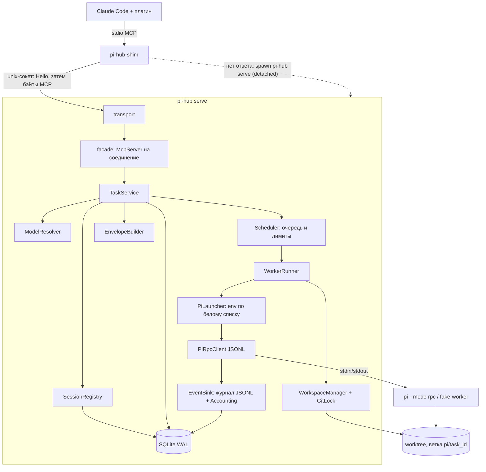

# Plan: Этап 1 — ядро pi-hub на одной машине

**Date:** 2026-11-26
**Status:** ✅ Implemented
**Priority:** P0
**Specification:** [docs/specs/2026-11-26-stage-1-core.md](../specs/2026-11-26-stage-1-core.md)

## Goal

Пользователь Claude Code включает режим архитектора, передаёт задачу воркеру Pi на дешёвой модели и получает конверт результата; воркер работает в своём worktree и коммитит в ветку `pi/<task_id>`, старший сливает её сам. Одна машина.

## Current state

- Монорепо pnpm, TypeScript 7, `tsc -b`, vitest, biome; CI собирает, линтует и тестирует.
- `packages/protocol/src` — статусы и `TRANSITIONS`, `ResultEnvelope`, zod-схемы инструментов, `Hello`/`HelloAck`/`HelloReject`, `PROTOCOL_VERSION`.
- `packages/hub/src` — только интерфейсы: `facade/mcp-facade.ts`, `sessions/session-manager.ts`, `pi-rpc/pi-rpc-client.ts`, `workspaces/workspace-manager.ts`, `quality/quality-gate.ts`, `router/router.ts`, `router/system-one/*`, `accounting/accounting.ts`, `storage/db.ts`, `config/schema.ts`, `daemon.ts`, `cli/main.ts`; миграция `storage/migrations/001_init.sql` готова.
- `packages/shim/src/index.ts`, `packages/pi-extension/src/index.ts`, `packages/fake-worker/src/index.ts` — заглушки; `packages/pi-extension/src/worker-prompt.md` — черновик промпта.
- `plugins/claude-code/` — манифест, `.mcp.json` (shim, `timeout` 30 мин), хуки-заготовки, `/architect`, `/workers`, скил.
- Установлены зависимости хаба: `@modelcontextprotocol/sdk` 1.32, `zod` 4, `yaml`, `smol-toml`, `pino`, `commander`.
- Проверено вживую: запуск Pi 1.6.1 с `-ne -e … --no-mcp -na` и `PI_CODING_AGENT_DIR`, диалоги расширения по RPC (ADR-0011).

## Solution architecture

Поток задачи: `start` → TaskService (проверки, ModelResolver, запись `queued`) → Scheduler (слот свободен) → WorkerRunner (GitLock → worktree → `setup` → PiLauncher → `prompt`) → события → EventSink (журнал, `steps`, проверка лимитов) → `agent_settled` → финализация (итог, авто-коммит, проверка атрибуции, предупреждения) → `done` → ожидающие `wait` просыпаются.

## Solution

### Protocol (`packages/protocol`)

#### Files:
- [x] `src/envelope.ts` — поле `warnings: string[]` в `ResultEnvelope`; тип `TaskSummaryRow` для `status`.
- [x] `src/tools.ts` — описания инструментов (короткие строки), `SendInput` с пометкой «продолжение»; `WaitInput.timeout` обрезается хабом, а не схемой.
- [x] `src/hub-wire.ts` — `Hello` дополняется `pid` shim; `HelloAck` возвращает `mode` и список видимых инструментов.
- [x] `src/status.ts` — переход `failed → running` (продолжение через `send`, D-007), `interrupted → running` уже есть; `queued` после рестарта остаётся `queued`.

#### Инструменты (контракт для старшего):

| Tool | Input | Output | Notes |
|------|-------|--------|-------|
| `architect_mode` | `{mode: on\|off}` | `{mode, running_tasks[]}` | при `on` → `tools/list_changed` |
| `start` | `{task, role?, model?, repo, base_branch}` | `{task_id, status, model, route_reason, warnings[]}` | ≤ 3 с |
| `wait` | `{task_id, timeout}` | `{status, summary?, cost_line?}` | потолок 1500 с, progress раз в 60 с |
| `status` | `{}` | `{tasks: TaskSummaryRow[]}` | только свои |
| `result` | `{task_id}` | `ResultEnvelope` | ≤ 2 КБ |
| `cancel` | `{task_id}` | `{status: cancelled}` | worktree сохраняется |
| `send` | `{task_id, message}` | `{status}` | только `interrupted`/`failed` |

### Hub (`packages/hub/src`)

#### Files:
- [x] `config/load.ts` — чтение `~/.pi-hub/config.yaml` (yaml), `.pi-hub.toml` проекта (smol-toml), раскрытие `~`, валидация `HubConfig`; загрузка `~/.pi-hub/.env` в отдельный объект секретов (не в `process.env`).
- [x] `config/schema.ts` — `pi.extension_path?`, `pi.agent_dir`, `worktrees_dir`, проектная схема (`delegation`, `setup`).
- [x] `config/paths.ts` — все пути `~/.pi-hub/*` в одном месте; проверка длины пути сокета ≤ 100 байт.
- [x] `log.ts` — pino в `~/.pi-hub/logs/hub.log`, дочерние логгеры с `task_id`/`senior_session_id`; маскирование значений секретов.
- [x] `storage/db.ts` — `node:sqlite` `DatabaseSync`, `PRAGMA journal_mode=WAL`, `foreign_keys=ON`, `busy_timeout`; раннер миграций по `schema_version`.
- [x] `storage/repos.ts` — запросы: проекты, сессии, задачи (CRUD, выборки по владельцу и статусу, следующий `task_id`), шаги (вставка, суммы по задаче и сессии).
- [x] `storage/migrations/002_task_extras.sql` — `tasks.warnings_json`, `tasks.assumptions_json`, `tasks.failure_reason`, `tasks.cost_usd` (кэш суммы), `tasks.attempt`.
- [x] `pi-rpc/jsonl.ts` — разбиение потока только по LF, отбрасывание `\r`, не `readline`.
- [x] `pi-rpc/pi-rpc-client.ts` — spawn, корреляция ответов по `id`, подписка на события, `prompt`, `follow_up`, `abort`, `get_last_assistant_text`, `switch_session`, `get_state`, `get_available_models`; остановка: закрыть stdin → SIGTERM → SIGKILL через 10 с.
- [x] `pi-rpc/events.ts` — zod-схемы нужного подмножества событий: `message_end` (usage, cost), `tool_execution_*` (для `report_assumption`), `agent_settled`, `auto_retry_end`, `extension_ui_request`, ответы.
- [x] `pi-rpc/launcher.ts` — сборка аргументов и окружения по ADR-0011: белый список (`PATH`, `HOME`, `LANG`, `LC_*`, `TMPDIR`, `PI_CODING_AGENT_DIR`, `PI_OFFLINE`, ключ провайдера по таблице «провайдер → переменная»), `--model провайдер/id`, `--session-dir`, `--name`, `-ne -e`, `-ns -np`, `--no-mcp -na`, `--append-system-prompt <файл>`.
- [x] `pi-rpc/provider-env.ts` — таблица «провайдер Pi → имя переменной ключа» для `deepseek`, `zai`, `moonshotai`, `openai`, `openrouter` (сверить с `env-api-keys` каталога Pi в фазе 0).
- [x] `workspaces/git.ts` — `execFile('git', …)` с таймаутом; `GitLock` — очередь промисов на `repo_root`.
- [x] `workspaces/workspace-manager.ts` — `create` (под GitLock: `worktree add -b pi/<id> <path> <base>`), `runSetup` (`sh -c <setup>` в worktree, таймаут 15 мин, первые 40 строк ошибок), `changedFiles` (`diff --name-only base...HEAD`), `isDirty`, `autoCommit` (под GitLock: `add -A`, `commit -m` от пользователя git), `commitMessages(base..branch)`, `baseIsStale` (грязное дерево основного репозитория или `base_branch` ≠ `HEAD`).
- [x] `workspaces/attribution.ts` — тот же шаблон, что в `scripts/check-attribution.sh` (одна константа, тест на совпадение).
- [x] `router/model-resolver.ts` — явная `model` → `roles[role].model` → `roles[default_role].model`; результат `{provider, modelId, role, routedBy, reason}`.
- [x] `accounting/accounting.ts` — `recordStep` из `message_end` (`cost_source = provider`, если `usage.cost.totalFromProvider`, иначе `pi_event`), сумма по задаче и сессии, `formatCostLine`, проверка `max_task_usd`.
- [x] `sessions/session-registry.ts` — создание старшей сессии при `Hello` (клиент, `parent_pid`, проект по `git rev-parse --show-toplevel` и `remote get-url origin`), режим сессии (по умолчанию из `.pi-hub.toml` / глобального), `last_seen_at`.
- [x] `tasks/task-service.ts` — точка входа для фасада: `start`, `status`, `result`, `cancel`, `send`, `waitFor`; все переходы через `transition()` с `TRANSITIONS`; эмиттер `task.changed`.
- [x] `tasks/scheduler.ts` — очередь `queued` в порядке создания, лимит `max_workers_hub`, запуск по освобождению слота. *(итог: встроен в `TaskService.pump()`)*
- [x] `tasks/worker-runner.ts` — жизненный цикл одного запуска: worktree → setup → промпт → запуск Pi → события → таймер `max_task_minutes` → финализация.
- [x] `tasks/finalize.ts` — итог (`SUMMARY:` или один `follow_up`), обрезка до 500 символов, авто-коммит, проверка атрибуции, предупреждения (пустой дифф, незавершённость), запись в задачу.
- [x] `tasks/recovery.ts` — при старте: живы ли `pid` у `running/planning/checking` → иначе `interrupted`; `queued` — в планировщик. *(итог: `TaskService.recover()`)*
- [x] `tasks/envelope.ts` — сборка `ResultEnvelope` из задачи и шагов; контроль размера (обрезка `changed_files` до 50 с пометкой).
- [x] `tasks/prompt.ts` — рендер `worker-prompt.md` (задача, ветка, правила) в `~/.pi-hub/prompts/<task_id>.md`.
- [x] `transport/unix-server.ts` — `net.Server` на сокете 0600; первая строка — `Hello` → `HelloAck`/`HelloReject`; затем сокет отдаётся фасаду.
- [x] `transport/socket-transport.ts` — MCP-транспорт поверх сокета (переиспользует `StdioServerTransport(readable, writable)` из SDK, если он принимает потоки; иначе свой `Transport` на JSON по строкам).
- [x] `facade/mcp-facade.ts` — `McpServer` на соединение, регистрация 7 инструментов, `enable/disable` по режиму (dynamic для Claude Code), отказ при `off`, `sendToolListChanged`.
- [x] `facade/wait.ts` — длинный опрос на `task.changed` с потолком клиента и progress-уведомлениями раз в 60 с. *(итог: `waitWithProgress` в `mcp-facade.ts`)*
- [x] `daemon.ts` — порядок старта: пути → lock-файл (`~/.pi-hub/hub.lock`, PID, проверка живости) → БД и миграции → recovery → планировщик → сокет; корректное завершение по SIGTERM (воркеры останавливаются, задачи → `interrupted`).
- [x] `cli/main.ts` — `serve`, `init`, `doctor`, `status` (commander).
- [x] `cli/init.ts` — интерактивные шаги (провайдер, модель по умолчанию, ключ скрыто, разрешённые репозитории), запись конфига и `.env` 0600 без перезаписи существующего, создание `~/.pi-hub/pi-agent`, подключение плагина Claude Code, финальная проверка модели.
- [x] `cli/doctor.ts` — проверки: конфиг, ключ, `pi --version` = закреплённой, путь расширения, Pi видит модель (`get_available_models` по RPC без промпта), git, сокет демона.
- [x] `cli/status.ts` — таблица задач всех сессий из БД (только чтение).

### Shim (`packages/shim/src`)

- [x] `index.ts` — подключение к сокету; при ошибке `ECONNREFUSED/ENOENT` — spawn `pi-hub serve` (`detached: true`, `stdio: 'ignore'`, `cwd: ~/.pi-hub`, `unref()`), повторные попытки до 3 с; `Hello` (`client` из `--client`, `parent_pid: process.ppid`, проект из `PI_HUB_PROJECT_DIR`/`cwd`); затем двусторонняя труба stdin/stdout ↔ сокет.
- [x] `fallback.ts` — если хаб так и не ответил: минимальный MCP-сервер на stdio с одним инструментом `architect_mode`, который возвращает «хаб не запущен: см. pi-hub doctor» (сессия не блокируется, ответ ≤ 5 с). *(итог: заглушка внутри `shim/src/index.ts`)*

### Pi extension (`packages/pi-extension`)

- [x] `src/index.ts` — фабрика расширения: инструмент `report_assumption(text)` (возвращает «записано»); загружается Pi через jiti прямо из исходника.
- [x] `src/pi-types.d.ts` — минимальные локальные типы `ExtensionAPI`/`Type` для проверки типов без зависимости от пакета Pi (PD-004).
- [x] `src/worker-prompt.md` — финальный текст: решать самому и вызывать `report_assumption`, коммитить без подписей ИИ, не выходить за worktree, закончить блоком `SUMMARY:`.

### Fake worker (`packages/fake-worker`)

- [x] `src/index.ts` — исполняемый файл с интерфейсом `pi --mode rpc` (те же аргументы игнорируются), сценарий из `PI_HUB_FAKE_SCENARIO` или `--scenario`.
- [x] `src/scenarios/*.ts` — `success` (правит файл в `cwd`, коммитит, шлёт `message_end` с usage и `agent_settled`), `no-summary`, `no-commit`, `empty-diff`, `crash`, `hang`, `expensive` (большой `cost`), `ai-attribution` (коммит с `Co-authored-by`). *(итог: сценарии в одном файле `src/index.ts`)*

### Claude Code plugin (`plugins/claude-code`)

- [x] `commands/architect.md`, `commands/workers.md` — сверить с итоговыми инструментами.
- [x] `skills/architect/SKILL.md` — правило «если `wait` вернул `running` — снова `wait`», дробление на 3–4 подзадачи, сообщать стоимость шага.
- [x] `hooks/hooks.json` — убрать хуки до этапа 2/4 (SessionStart и Stop не используются на этапе 1), чтобы не было лишних процессов. *(итог: каталог `hooks/` удалён целиком)*

### Scripts and docs

- [x] `scripts/e2e.ts` + `package.json` (`pnpm e2e`) — временный git-репозиторий, демон с отдельным `PI_HUB_HOME`, MCP-клиент SDK через shim: `architect_mode on` → `start` → `wait` → `result` → `git merge`; модель — самая дешёвая из конфига.
- [x] `README.md` — установка из репозитория (D-005), `pi-hub init`, первый запуск.
- [x] `docs/adr/0004-pi-rpc-client.md` — зафиксировать «свой тонкий клиент» (PD-001).

## Implementation phases

### Phase 0: Проверка допущений (estimate: 2 h)
- [x] Выяснить, как подключить локальный плагин Claude Code из папки без marketplace (команда CLI или запись в настройках) → записать в `cli/init.ts` план и в README.
- [x] Записать реальную RPC-сессию Pi 1.6.1 (дешёвая модель, задача «создай файл») в `packages/hub/test/fixtures/pi-session-success.jsonl` — источник контрактных тестов.
- [x] Сверить имена переменных ключей провайдеров с каталогом Pi (`env-api-keys`) → `pi-rpc/provider-env.ts`.
- [x] Проверить, принимает ли `StdioServerTransport` SDK произвольные потоки (`net.Socket`) → выбор в `transport/socket-transport.ts`.
- **Independent check:** заметки в разделе «Plan decisions» дополнены фактами; фикстура лежит в репозитории без секретов (`pnpm check:secrets` по фикстуре — grep по ключам из `.env`).

### Phase 1: Основа — протокол, конфиг, хранилище, логи (estimate: 6 h)
- [x] [P] Протокол: `warnings`, `TaskSummaryRow`, `Hello`, переход `failed → running` → `packages/protocol/src/*`
- [x] [P] Пути и конфиг: `config/paths.ts`, `config/schema.ts`, `config/load.ts` (+ проектный `.pi-hub.toml`, `.env` в объект секретов)
- [x] [P] Логи с маскированием → `log.ts`
- [x] Хранилище: `storage/db.ts`, `storage/repos.ts`, `002_task_extras.sql`; копирование `.sql` в `dist` в скрипте сборки `packages/hub/package.json`
- [x] Тесты: миграции на чистой БД и повторный запуск; переходы статусов; загрузка конфига (ошибки валидации, `~`, длина сокета); маскирование секретов
- deviated: `Hello` передаёт `cwd` вместо `project` — git-корень и remote определяет хаб (SessionRegistry), shim остаётся без логики; добавлено поле `pid`.
- deviated: `HelloAck` без списка инструментов — список отдаёт MCP (`tools/list`), дублировать не нужно.
- deviated: `INSERT INTO schema_version` убран из `001_init.sql` — версию ведёт раннер миграций (001 нигде не применялась).
- deviated: в `002_task_extras.sql` добавлены `task_text`, `base_branch`, `started_at` — без них задачу нельзя перезапустить и посчитать время.
- deviated: `data_dir` убран из конфига — все пути из `HubPaths` с переопределением `PI_HUB_HOME`; вложенные секции конфига используют `prefault`, пустой файл валиден.
- deviated: сборка — корневой `build` = `tsc -b packages/* && node scripts/copy-assets.mjs`.
- **Independent check:** `pnpm test` — новые модульные тесты зелёные; `pnpm build` копирует миграции в `dist`.

### Phase 2: Исполнение воркера без MCP (estimate: 12 h)
- [x] JSONL и RPC-клиент → `pi-rpc/jsonl.ts`, `pi-rpc/events.ts`, `pi-rpc/pi-rpc-client.ts`
- [x] Запуск с белым списком окружения → `pi-rpc/launcher.ts`, `pi-rpc/provider-env.ts`
- [x] [P] Фейковый воркер и сценарии → `packages/fake-worker/src/**`
- [x] [P] Git и worktree: `workspaces/git.ts` (GitLock), `workspaces/workspace-manager.ts`, `workspaces/attribution.ts`
- [x] [P] Расширение и промпт: `packages/pi-extension/src/index.ts`, `pi-types.d.ts`, `worker-prompt.md`; `tasks/prompt.ts`
- [x] Учёт: `accounting/accounting.ts` (шаги из `message_end`, сумма, строка стоимости, проверка лимита)
- [x] Выбор модели → `router/model-resolver.ts`
- [x] Тесты: JSONL с `U+2028` внутри строки; контрактный тест на фикстуре фазы 0; окружение воркера не содержит посторонних ключей; три параллельных `worktree add` в один репозиторий; `setup` с ошибкой; совпадение шаблона атрибуции со скриптом CI; выбор модели (3 уровня)
- deviated: фейковый воркер — один TS-файл без относительных импортов, Node 26 запускает его напрямую (`node index.ts`); сценарий задаётся моделью `--model fake/<scenario>`, поэтому белый список окружения не нужно обходить. Добавлены сценарии `incomplete`, `assumption`.
- deviated: текст задачи отправляется воркеру как пользовательский `prompt`; файл `--append-system-prompt` содержит только правила, ветку и базу.
- deviated: команда `setup` тоже получает окружение по белому списку (`allowlistedEnv`, без ключей) — найдено на самопроверке: скрипты установки зависимостей видели бы ключи, унаследованные демоном.
- deviated: авто-коммит хаба — `git commit --no-verify`: страховочный коммит не должен падать на хуках проекта (проверка качества — этап 2).
- deviated: расширение без зависимости от `@pi-hub/protocol`, грузится Pi из `src/index.ts`; хаб зависит от `@pi-hub/pi-extension` (поиск пути через `require.resolve`) и в dev — от `@pi-hub/fake-worker`. Проверено: Pi 1.6.1 загружает расширение без `extension_error`.
- deviated: заглушка `router/router.ts` удалена — на этапе 1 только `router/model-resolver.ts`; интерфейс роутера появится на этапе 3.
- deviated: независимая проверка — `test/worker-smoke.test.ts` (успех, падение воркера, abort зависшего воркера).
- **Independent check:** интеграционный тест `worker-runner.smoke` запускает фейковый воркер `success` в временном репозитории напрямую через `PiRpcClient` + `WorkspaceManager` и получает коммит в ветке `pi/t_0001` и строку в `steps`.

### Phase 3: Сервис задач — жизненный цикл без MCP (estimate: 10 h)
- [x] `tasks/task-service.ts`, `tasks/scheduler.ts`, `tasks/worker-runner.ts`
- [x] `tasks/finalize.ts` (итог и `follow_up`, авто-коммит, атрибуция, предупреждения)
- [x] `tasks/recovery.ts`, продолжение через `send` (`switch_session` на `pi_session_path`)
- [x] `tasks/envelope.ts` (+ контроль 2 КБ), `sessions/session-registry.ts`
- [x] Лимиты: `max_task_minutes` (таймер), `max_task_usd` (после каждого шага), остановка ≤ 10 с
- [x] Тесты (фейковый воркер, без сети): успех; `no-summary` → ровно один `follow_up`; `no-commit` → авто-коммит; `empty-diff` → предупреждение; `ai-attribution` → предупреждение с хешем; `crash` → `failed`; `hang` → `failed` по таймеру (таймер сокращён в тесте); `expensive` → `failed` «лимит стоимости»; очередь при `max_workers = 2`; `cancel` ≤ 10 с, worktree на месте; рестарт сервиса → `interrupted` → `send` → `done`; грязная база → предупреждение в `start`
- deviated: миграция `003_task_base_commit.sql` — коммит базы на момент старта; `changed_files` и проверка коммитов считаются от него, даже если `base_branch` ушла вперёд.
- deviated: планировщик встроен в `TaskService.pump()` (отдельный `scheduler.ts` не понадобился); восстановление — `TaskService.recover()` (без `recovery.ts`).
- deviated: `recover()` не посылает сигналы по сохранённому PID — после перезагрузки PID может принадлежать чужому процессу; Pi сам завершается при закрытии stdin (найдено на самопроверке).
- deviated: финализация идёт в статусе `checking` (running → checking → done), качество — `SKIPPED`.
- deviated: `send` без сохранённой сессии Pi (задача упала до старта Pi) запускает задачу заново с текстом задачи + сообщением.
- deviated: добавлены `errors.ts` (`HubError` с кодами для фасада) и `workspaces/repo.ts` (git-корень, remote).
- **Independent check:** `pnpm test` — интеграционные тесты сценариев 1, 3, 4 на уровне `TaskService` зелёные.

### Phase 4: Демон, транспорт, фасад MCP, shim (estimate: 10 h)
- [x] Демон: lock-файл, порядок старта, SIGTERM → `daemon.ts`, `cli/main.ts serve`
- [x] Транспорт: `transport/unix-server.ts`, `transport/socket-transport.ts`, рукопожатие с проверкой версии
- [x] Фасад: `facade/mcp-facade.ts` (7 инструментов, dynamic-список, отказ при `off`, `list_changed`), `facade/wait.ts` (потолок, progress)
- [x] Shim: `packages/shim/src/index.ts` (подключение, авто-запуск detached, труба), `fallback.ts`
- [x] Тесты: MCP-клиент SDK → shim → демон (фейковый воркер): при старте виден только `architect_mode`; `on` → `list_changed` и 7 инструментов; вызов при `off` → отказ; полный цикл `start/wait/result`; `wait` возвращает `running` по потолку (сокращён в тесте) и шлёт progress; два shim одновременно → один демон; демон убит → shim-заглушка отвечает ≤ 5 с; `.pi-hub.toml delegation = "on"` → режим включён сразу; несовместимая версия протокола → `HelloReject`
- deviated: `facade/wait.ts` не понадобился — `waitWithProgress` в `facade/mcp-facade.ts`; progress-уведомления идут, только если клиент передал `progressToken`.
- deviated: инструментов делегирования на этапе 1 шесть + `architect_mode` = 7 (`usage_report` — этап 2); описания инструментов вынесены в `TOOL_DESCRIPTIONS` протокола, `HelloSchema` (zod) — тоже в протоколе.
- deviated: в конфиг добавлен `pi.bin_args` — демон запускает обёртку или фейкового воркера; путь сокета для shim — `PI_HUB_SOCKET` или `<PI_HUB_HOME>/hub.sock` (shim не читает YAML), команда запуска демона — `PI_HUB_SERVE_COMMAND` (JSON-массив, по умолчанию `["pi-hub","serve"]`).
- deviated: NFR «shim отвечает на initialize ≤ 1 с»: при авто-запуске демона ответ приходит до ~3 с (shim держит stdin на паузе до рукопожатия). В пределах таймаутов запуска MCP-сервера клиентов (Codex 10 с, Claude Code 30 с).
- deviated: `pnpm test` = `pnpm build && vitest run` (shim и CLI в тестах запускаются из `dist`); `pnpm typecheck` = `tsc -b packages/*` — прежний `tsc -b --noEmit` не работал со ссылками между проектами и ломал бы CI с первого коммита.
- deviated: найдено в тестах — заглушка shim завершалась: явная пауза stdin не снимается слушателем транспорта SDK; добавлен `process.stdin.resume()`.
- **Independent check:** интеграционный тест `mcp.e2e-fake` проходит сценарий 1 целиком через shim на фейковом воркере.

### Phase 5: CLI и плагин (estimate: 6 h)
- [x] `cli/init.ts` (без перезаписи, `.env` 0600, `pi-agent`, подключение плагина по итогам фазы 0, финальная проверка модели)
- [x] `cli/doctor.ts`, `cli/status.ts`
- [x] Плагин: команды, скил, удалить хуки этапа 2 → `plugins/claude-code/**`
- [x] README: установка и первый запуск
- [x] Тесты: `init` во временном `HOME` (повторный запуск не меняет файлы, права `.env`); `doctor` на фейковом `pi` (версия не та → ошибка, модель не видна → ошибка)
- deviated: `init` не задаёт вопросов, если конфиг уже есть (модель берётся из него), и только дописывает в существующий `.env` ключ, которого там нет; без вопросов (`--yes`) ключ берётся из переменной провайдера в окружении, а не из аргумента — чтобы не попадать в историю оболочки.
- deviated: `doctor` дополнительно проверяет `pi-hub-shim` в PATH и права `.env`; «демон не запущен» и «shim не в PATH» — предупреждения, а не ошибки. Проверка модели запускает Pi с `--no-session -ne -ns -np --no-mcp -na`, `PI_CODING_AGENT_DIR` хаба и `PI_OFFLINE=1`; без ключа не запускается.
- deviated: из плагина удалены `hooks/` и `scripts/` целиком (вернутся на этапах 2 и 4), из `.mcp.json` — неиспользуемая `PI_HUB_STATE_DIR`; `/workers` на этапе 1 — только список задач сессии и `doctor` (`all` и `adopt` — со следующих этапов).
- deviated: `status` открывает БД только на чтение (`readOnly`), без `Repos`/миграций — писать в SQLite может только демон.
- deviated: дополнительно проверено на настоящем Pi 1.6.1 с фиктивным ключом: `get_available_models` возвращает модели провайдера, несуществующая модель даёт ошибку, ключ встречается только в `.env`.
- **Independent check:** во временном `HOME`: `pi-hub init` (неинтерактивно, флагами) → `pi-hub doctor` выдаёт все проверки «OK» при фейковом `pi`.

### Phase 6: Сквозная проверка и закрытие (estimate: 4 h)
- [x] `scripts/e2e.ts`, `pnpm e2e` на реальном Pi и дешёвой модели
- [x] Ручной прогон в Claude Code: `/architect on` → задача → приёмка → `git merge` (выполнил автор, 2026-11-27)
- [x] Проверка утечки ключей: поиск значений из `.env` по `~/.pi-hub` (кроме `.env`) и репозиторию после прогона
- [x] ADR-0004 — решение PD-001; обновить `docs/architecture/overview.md`, если модули назвались иначе
- [x] `pnpm build && pnpm lint && pnpm test`, CI зелёный
- deviated: e2e прогнан на `9router/Deepseek-v4.1-flash` (по выбору автора): провайдер зарегистрирован личным расширением Pi, поэтому добавлена настройка `pi.extensions` — расширения-провайдеры, которые хаб явно передаёт воркеру через `-e` (PD-013, дополнение к ADR-0011). Два прогона подряд — `done` за ~20 с, `git merge` чистый; стоимость 0 — расширение не объявляет цены.
- deviated: проверка утечки — в самом `pnpm e2e` (ключ провайдера из `.env` ищется по временному хабу, тестовому репозиторию и рабочей копии); для `9router` ключ из файла расширения дополнительно найден поиском по сохранённому (`--keep`) хабу и репозиторию — совпадений нет.
- deviated: дописаны тесты на непокрытые критерии спецификации: ошибка `setup` → `failed` без шагов; `/architect off` при запущенной задаче — отказ `start`, задача живёт после закрытия клиента; конверт ≤ 2 КБ при 20 файлах.
- deviated: найдено при повторных прогонах — тест «два shim» изредка падал: второй демон мог прочитать lock-файл до записи PID первым, счесть его брошенным и удалить. `acquireLock` теперь создаёт lock жёсткой ссылкой на файл с уже записанным PID; модульные тесты на lock; 12 прогонов теста подряд — без падений.
- deviated: CI не запускался ни разу — workflow слушал ветку `main`, а репозиторий в `master`; триггер дополнен `master`. Первый же прогон нашёл ошибку: по таймауту `setup` убивался только `sh`, а форкнутый им процесс (dash на Linux) продолжал жить и держал вывод — таймаут не срабатывал. `runSetup` запускает команду в своей группе процессов и убивает группу.
- **Independent check:** `pnpm e2e` проходит; ворота этапа 1 из спецификации отмечены.

**Итого:** ~50 h.

## Traceability: Requirements → Tasks

| Requirement | Phase | Tasks |
|-------------|-------|-------|
| FR-001 ✅ | 4 | `daemon.ts`: lock-файл, сокет 0600; shim запускает detached |
| FR-002 ✅ | 4 | `packages/shim`: труба, `Hello`, авто-запуск ≤ 3 с |
| FR-003 ✅ | 1 | `storage/db.ts`, миграции |
| FR-004 ✅ | 3 | `session-registry.ts`: сессия по `parent_pid` и проекту |
| FR-005 ✅ | 4 | `facade/mcp-facade.ts`: dynamic-список, отказ при `off` |
| FR-006 ✅ | 1, 4 | `config/load.ts` (`.pi-hub.toml`), `architect_mode` |
| FR-007 ✅ | 4 | 7 инструментов в фасаде, описания в `protocol/tools.ts` |
| FR-008 ✅ | 3 | `task-service.start`: режим, `allowed_repos`, `base_branch` |
| FR-009 ✅ | 2 | `router/model-resolver.ts` |
| FR-010 ✅ | 2 | `workspace-manager.create/changedFiles` |
| FR-011 ✅ | 2 | `pi-rpc/launcher.ts`, `provider-env.ts` |
| FR-012 ✅ | 2 | `pi-rpc/jsonl.ts`, `pi-rpc-client.ts` |
| FR-013 ✅ | 1, 2 | `log.ts` (маскирование), журнал событий в `worker-runner` |
| FR-014 ✅ | 1, 3 | `TRANSITIONS`, `task-service.transition` |
| FR-015 ✅ | 2 | `pi-extension`: `report_assumption`, промпт |
| FR-016 ✅ | 3 | `finalize.ts`: авто-коммит, `attribution.ts` |
| FR-017 ✅ | 1, 3 | `warnings` в протоколе, `tasks/envelope.ts`, `formatCostLine` |
| FR-018 ✅ | 2 | `accounting.recordStep` |
| FR-019 ✅ | 4 | `facade/wait.ts` |
| FR-020 ✅ | 3 | `tasks/scheduler.ts` |
| FR-021 ✅ | 3 | таймер `max_task_minutes` в `worker-runner` |
| FR-022 ✅ | 3 | `tasks/recovery.ts` |
| FR-023 ✅ | 3 | `send` → `switch_session` |
| FR-024 ✅ | 2, 3 | `workspace-manager.runSetup`, вызов до Pi |
| FR-025 ✅ | 2, 3 | проверка лимита в `accounting`, остановка в `worker-runner` |
| FR-026 ✅ | 3 | `finalize.ts`: `SUMMARY:` и один `follow_up` |
| FR-027 ✅ | 3 | `finalize.ts`: пустой дифф, незавершённость |
| FR-028 ✅ | 2 | `GitLock` в `workspaces/git.ts` |
| FR-029 ✅ | 3 | `baseIsStale` в `start` |
| FR-030 ✅ | 5 | `cli/init.ts` |
| FR-031 ✅ | 5 | `cli/doctor.ts` |
| FR-032 ✅ | 5 | `plugins/claude-code/**` |
| FR-033 ✅ | 2 | `packages/fake-worker` |
| FR-040 ✅ | 5 | `cli/status.ts` |

## Complexity & principle deviations

| Deviation | Principle / simpler alternative | Why justified |
|-----------|--------------------------------|---------------|
| Shim-заглушка с собственным MCP-сервером, когда хаб недоступен (`fallback.ts`) | «Shim — прозрачная труба» (ADR-0002) | Без неё недоступный хаб даёт ошибку запуска MCP-сервера в Claude Code; принцип «не блокировать старшего» важнее. Заглушка — один инструмент, без логики |
| Новая зависимость для скрытого ввода ключа в `init` | Встроенный `node:readline` | Скрытый ввод и выбор из списка на `readline` — ручная работа с raw-режимом терминала; берём одну небольшую библиотеку (PD-003) |

## Risks and mitigations

| Risk | Likelihood | Impact | Mitigation |
|------|------------|--------|------------|
| Формат RPC Pi отличается от документации в деталях | Medium | High | Фаза 0 записывает реальную сессию, контрактный тест на ней; zod-схемы только для нужных полей, остальное игнорируется |
| `node:sqlite` ведёт себя иначе под нагрузкой (experimental) | Low | Medium | Все запросы через `repos.ts`; `busy_timeout`; запасной драйвер по ADR-0003 без изменения вызывающего кода |
| Автоподключение плагина Claude Code невозможно | Medium | Low | Фаза 0; запасной путь — точные команды от `init` |
| Detached-демон теряет логи старта | Medium | Medium | Ранний pino в файл до любых действий; `doctor` показывает хвост `hub.log` |
| Гонки `wait`/`cancel`/финализации | Medium | Medium | Все переходы через один `transition()` в одном процессе; тесты на гонки в фазе 3 |
| Дорогая модель по ошибке в конфиге | Low | High | `max_task_usd` по умолчанию 2 $; `doctor` показывает модели ролей и цены из каталога Pi |
| TypeScript 7 ломает инструментарий | Low | Medium | Откат на 6.x не затрагивает код (stack.md) |

## Dependencies

### Packages / Libraries
- Уже есть: `@modelcontextprotocol/sdk`, `zod`, `yaml`, `smol-toml`, `pino`, `commander`, `vitest`, `biome`.
- Новая: `@inquirer/prompts` — интерактивный `init` (скрытый ввод, выбор) (PD-003).
- Без новых зависимостей: git через `execFile`, SQLite через `node:sqlite`, RPC Pi — свой клиент.

### Related tasks
- T-004 (этот план). Следующие этапы опираются на `TaskService`, `PiRpcClient` и фасад.

## Deferred questions

| Question | Why deferred | When the answer is needed | Who decides |
|----------|--------------|---------------------------|-------------|
| — | — | — | — |

## Plan decisions

| # | Question | Decision | Date |
|---|----------|----------|------|
| PD-001 | Готовый `RpcClient` Pi или свой | Свой тонкий клиент (~200 строк, JSONL только по LF, zod-схемы нужных событий): хаб не зависит от пакета Pi, фейковый воркер подключается тем же путём, изменения формата ловят контрактные тесты | 2026-11-26 |
| PD-002 | Сквозной тест на настоящем Pi | Локальный скрипт `pnpm e2e` вручную перед закрытием этапа и после обновления Pi, на самой дешёвой модели; в CI ключей нет | 2026-11-26 |
| PD-003 | Интерактивный ввод в `init` | `@inquirer/prompts` (скрытый ввод ключа, выбор из списка); есть неинтерактивный режим флагами для тестов и build-box | 2026-11-26 |
| PD-004 | Типы для расширения Pi | Минимальные локальные объявления `pi-types.d.ts` вместо зависимости от пакета Pi; расширение грузится Pi из исходника через jiti | 2026-11-26 |
| PD-005 | Где лежат worktree | `~/.pi-hub/worktrees/<project_id>/<task_id>` — вне репозитория старшего, не попадают в его `git status` и поиск | 2026-11-26 |
| PD-006 | Транспорт MCP поверх сокета | После строки `Hello` — тот же JSON-RPC по строкам, что в stdio; shim копирует байты; хаб переиспользует stdio-транспорт SDK на потоках сокета (проверка в фазе 0) | 2026-11-26 |
| PD-007 | Миграции в сборке | `.sql` остаются файлами; сборка хаба копирует их в `dist/storage/migrations` | 2026-11-26 |
| PD-009 | Фаза 0: транспорт SDK поверх сокета | Проверено: `StdioServerTransport(socket, socket)` работает на unix-сокете; байты MCP, пришедшие в одном пакете с `Hello`, возвращаются в поток через `socket.unshift`; закрытие сокета нужно пробрасывать в `transport.close()` вручную | 2026-11-26 |
| PD-010 | Фаза 0: переменные ключей провайдеров | Таблица из `@earendil-works/pi-ai` 1.6.1 сохранена в `pi-rpc/provider-env.ts` (40 провайдеров; `moonshotai` → `MOONSHOT_API_KEY`, `zai` → `ZAI_API_KEY`); перепроверять при смене версии Pi | 2026-11-26 |
| PD-011 | Фаза 0: подключение плагина Claude Code | Корень репозитория — локальный marketplace (`.claude-plugin/marketplace.json`, плагин `pi-hub` из `./plugins/claude-code`); `init` выполняет `claude plugin marketplace add <repo>` и `claude plugin install pi-hub@pi-hub-local --scope user`; если `claude` нет в PATH (desktop-приложение), печатает эти команды. Отдельного подтверждения для MCP и хуков плагина не требуется | 2026-11-26 |
| PD-012 | Фаза 0: запись реальной сессии и изоляция воркера | Фикстура `packages/hub/test/fixtures/pi-session-success.jsonl` (openai-codex/gpt-6-luna, задача «создай hello.txt и закоммить»). Найдено: без `-ns -np` в первое сообщение модели попадают личные скилы пользователя (`~/.pi/agent/skills`, `~/.agents/skills`, скилы npm-пакетов Pi) даже при `-ne -nc` → запуск воркера дополняется флагами `-ns -np`. В `usage.cost` есть `totalFromProvider` — источник `cost_source` (`provider` / `pi_event`) | 2026-11-26 |
| PD-013 | Провайдер, зарегистрированный личным расширением Pi (`9router`), недоступен воркеру при `-ne` | Настройка `pi.extensions` в `config.yaml`: явный список расширений-провайдеров, хаб передаёт каждое через `-e`, `-ne` остаётся; ключ остаётся в расширении, хаб его не читает. OAuth-подписки (`auth.json`) на этапе 1 не поддерживаются | 2026-11-26 |
| PD-008 | Хуки плагина на этапе 1 | Не используются (SessionStart и Stop нужны с этапов 2 и 4); убраны из `hooks.json`, чтобы не запускать лишние процессы | 2026-11-26 |

## Tech Debt

| # | Description | Phase | Priority |
|---|-------------|-------|----------|
| TD-006 | ✅ Закрыт 2026-11-27 (найден при закрытии TD-001): `PiRpcClient.stop()` не сбрасывал таймер ожидания, если Pi завершался раньше, — `doctor` висел ещё 2 с после проверок, тест `init` через CLI шёл 4,8 с при лимите vitest 5 с и падал через раз. Таймер сбрасывается, регрессионный тест на время выхода `doctor` | 5 | — |
| TD-005 | ✅ Закрыт 2026-11-27: проверено на настоящем Claude Code 2.1.331 (CLI из приложения, изолированный `CLAUDE_CONFIG_DIR`) — `marketplace add` и `plugin install` проходят, повторный запуск завершается с кодом 0, `connectPlugin` дважды вернул `done: true`, `plugin validate` проходит; плагин отдаёт MCP-сервер `pi-hub-shim`. Код не менялся | 5 | — |
| TD-003 | `facade/mcp-facade.ts`: регистрация инструментов через `as never` — обойти перегрузки `registerTool` SDK типобезопасной обёрткой | 4 | Low |
| TD-004 | Сокет получает права 0600 сразу после `listen` — короткое окно; создавать в каталоге 0700 или через umask | 4 | Low |
| TD-002 | `ensureSummary`: таймер таймаута не очищается после ответа (держит цикл событий до 120 с) — очистить в `finally` | 3 | Low |
| TD-001 | ✅ Закрыт 2026-11-27: `packages/hub/tsconfig.test.json` (src + test, `noEmit`), шаг в `pnpm typecheck` и тем самым в CI. Найдена одна ошибка — пустая проверка `until(async () => true)` в `mcp-e2e.test.ts`, удалена | 2 | — |

## Retrospective

**Review date:** 2026-11-27
**Status:** ✅ Implemented

### Summary

| Metric | Plan | Actual |
|--------|------|--------|
| Phases | 7 (0–6) | 7 |
| Tasks (чек-листы фаз) | 36 | 36 выполнено, 0 пропущено |
| Files | ~70 в разделе «Solution» | 89 изменено (+7003 / −374) |
| Estimate (hours) | ~50 | ~4 ч реального времени по коммитам (19:01–22:57) + ручной прогон; оценки писались для человека |
| Commits | — | 8 (+1 этот) |
| Тесты | — | 91 (vitest, без сети) + `pnpm e2e` на настоящем Pi |

### Implementation commits

| Hash | Description | Files |
|------|-------------|-------|
| `f9d5827` | feat(hub): config, logging and SQLite storage foundation — фаза 1 | 20 |
| `46a8672` | feat(hub): worker execution core without MCP — фаза 2 | 31 |
| `29d958d` | feat(hub): task service with full task lifecycle — фаза 3 | 14 |
| `a241bb4` | feat(hub): daemon, unix socket transport, MCP facade and shim — фаза 4 | 15 |
| `e7107b4` | feat(hub): init, doctor, status CLI and Claude Code plugin cleanup — фаза 5 | 19 |
| `85359f1` | feat(hub): real-Pi e2e, provider extensions, lock race fix — фаза 6 | 21 |
| `9d56ed0` | fix(hub): kill the whole setup process group on timeout | 3 |
| `258077d` | docs(spec): stage 1 CI criterion met | 1 |

Фаза 0 (проверка допущений) вошла в `bc4ceac` вместе со спецификацией и планом.

### Deviations from the plan

#### Added (not in the plan)
- Настройка `pi.extensions` (PD-013): провайдер автора `9router` зарегистрирован личным расширением Pi и невидим воркеру при `-ne`; без неё e2e на выбранной модели невозможен.
- Миграция `003_task_base_commit.sql`: дифф и проверка коммитов считаются от коммита базы на момент старта.
- `pi.bin_args`, переменные `PI_HUB_SOCKET`, `PI_HUB_SERVE_COMMAND`, `PI_HUB_HOME` — для тестов, e2e и обёрток Pi.
- `errors.ts` (`HubError` с кодами), `workspaces/repo.ts`, `scripts/copy-assets.mjs`.
- Флаги `-ns -np` при запуске воркера (PD-012): без них в контекст воркера попадали личные скилы пользователя.
- Окружение по белому списку и для команды `setup`, `git commit --no-verify` для страховочного коммита.
- Дополнительные проверки `doctor`: `pi-hub-shim` в PATH, права `.env`.

#### Skipped (in the plan, not done)
- Нет. Отдельные файлы `tasks/scheduler.ts`, `tasks/recovery.ts`, `facade/wait.ts`, `shim/fallback.ts`, `fake-worker/src/scenarios/*` не создавались — их логика встроена в соседние модули (см. «Changed»).

#### Changed (done differently)
- Планировщик и восстановление — методы `TaskService` (`pump`, `recover`); длинный опрос — `waitWithProgress` в фасаде; заглушка shim — в `index.ts`; фейковый воркер — один TS-файл, сценарий задаётся моделью `fake/<scenario>`.
- `Hello` передаёт `cwd` и `pid`, git-корень определяет хаб; `HelloAck` без списка инструментов.
- Текст задачи уходит воркеру как `prompt`, системный файл — только правила.
- `recover()` не шлёт сигналы по сохранённому PID (PID мог перейти к чужому процессу).
- Финализация в статусе `checking`, качество — `SKIPPED` до этапа 2.
- `pnpm test` = `build + vitest`, `pnpm typecheck` = `tsc -b packages/*`.
- NFR «shim отвечает на `initialize` ≤ 1 с» при авто-запуске демона выполняется за ~3 с — в пределах таймаутов клиентов.
- Плагин: удалены `hooks/` и `scripts/` целиком, `/workers` на этапе 1 — только список и `doctor`.

### Requirements coverage

| Requirement | Status | Comment |
|-------------|--------|---------|
| FR-001…FR-033, FR-040 | ✅ Implemented | Все 34 требования; критерии сценариев и критерии успеха спецификации отмечены |
| FR-002 (NFR ≤ 1 с) | ✅ с оговоркой | ≤ 3 с при авто-запуске демона, см. «Changed» |
| FR-017/FR-018 (стоимость) | ✅ с оговоркой | Для провайдеров из расширений без цен (`9router`) стоимость 0 $ — цены импортируются на этапе 2 |

### Lessons

1. **CI надо видеть зелёным с первого коммита** — workflow слушал `main` при ветке `master` и не запустился ни разу за шесть фаз. Первый же прогон нашёл реальную ошибку (таймаут `setup` не убивал дочерние процессы на Linux). Рекомендация: в фазе 1 любого плана — «CI запустился и зелёный» как пункт независимой проверки.
2. **macOS скрывает ошибки управления процессами** — `sh -c` на macOS и dash на Linux ведут себя по-разному; убивать нужно группу процессов. Тесты с дочерними процессами гонять и в CI на Linux.
3. **Нестабильный тест — это баг, пока не доказано обратное** — редкое падение «два shim» оказалось настоящей гонкой lock-файла. Повторный прогон 10+ раз подряд стоит делать для каждого теста с несколькими процессами.
4. **Фаза проверки допущений окупилась** — запись реальной RPC-сессии нашла утечку личных скилов в воркер (PD-012), проверка транспорта SDK дала готовое решение (PD-009). Повторять фазу 0 на этапах 2–3 (Extension UI, профиль Codex).
5. **Окружение автора — часть e2e** — провайдер через личное расширение не был предусмотрен ни спецификацией, ни планом; появилась настройка `pi.extensions`. Перед e2e спрашивать, какой моделью и как настроенным Pi будет пользоваться автор.
6. **Перечень файлов в «Solution» устаревает** — пять файлов растворились в соседних модулях, таблица трассировки ссылалась на несуществующие файлы. Для следующих планов: перечень файлов — ориентир, в трассировке указывать модуль/функцию.
7. **Оценки в часах для агента неинформативны** — ~50 ч плана против ~4 ч реального времени. Для планов, исполняемых агентом, оценивать объём (файлы, тесты, риски), а не часы.

### Recommendations

- Технический долг TD-001…TD-005 перенесён в Backlog `TASKS.md`; TD-001 (типизация тестов) и TD-005 (автоподключение плагина через `claude`) — до начала этапа 2.
- Этап 2 начать с фазы 0: записать реальный обмен Extension UI (`ask`) и событие стоимости у провайдеров с ценами.
- Импорт цен (этап 2) должен покрывать провайдеров из расширений, либо `doctor` предупреждает, что для модели нет цены.
- Держать `pnpm e2e` обязательным перед закрытием каждого этапа и после обновления Pi.

### Closing deferred questions

| Question | Decision | Where it was recorded |
|----------|----------|-----------------------|
| — | Отложенных вопросов в плане и спецификации не было | — |
