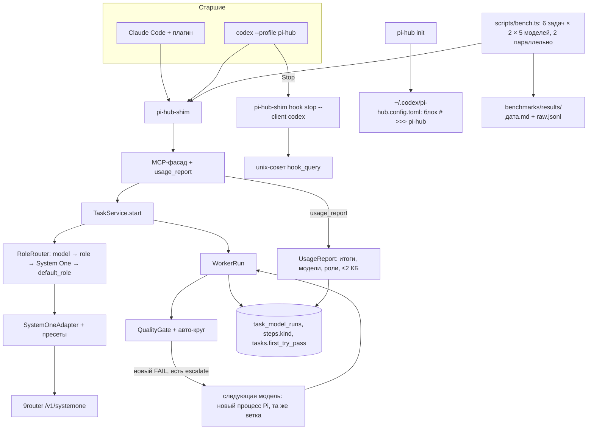

# Plan: Этап 3 — роутинг, эскалация, Codex и отчёт о расходах

**Date:** 2026-11-27
**Status:** 🔄 Implementing
**Priority:** P1
**Specification:** [docs/specs/2026-11-27-stage-3-routing-codex.md](../specs/2026-11-27-stage-3-routing-codex.md)

## Goal

Codex работает архитектором наравне с Claude Code; задача, не доведённая до `PASS`, сама продолжается на следующей модели роли; роль без подсказки старшего выбирает System One (9router, `typesafe/jev-latest`); расходы — одним `usage_report`; таблица ролей опирается на замер пяти моделей на шести эталонных задачах.

## Current state

- **Роутер** `packages/hub/src/router/model-resolver.ts`: старший → роль → `default_role`; `routedBy` = `architect | rules`. `RoleRule` (`config/schema.ts`) уже имеет `fallback`/`escalate`; описания роли нет. `router.system_one` — только схема.
- **Запуск воркера** `tasks/worker-runner.ts`: один процесс Pi на запуск (`PiRpcClient` создаётся в `run()`), цикл ходов `converse()`, финализация `finalize()`, проверка `deps.quality.check()` с авто-кругом; итог `done` с `PASS`/`FAIL`/`SKIPPED`. Модель берётся из `task.model`; `pi_session_path` пишется один раз.
- **Хранилище** `storage/migrations/001…004`: `tasks.model`, `routed_by` (CHECK уже допускает `system_one`, `escalation`), `escalated_from_task_id`, `attempt`; `steps` без признака «шаг роутера». Отчётов по периоду/модели/роли нет (`repos.ts`: `taskUsage`, `sessionCost`, `sessionUnknownSteps`).
- **Протокол** `packages/protocol/src/tools.ts`: `UsageReportInput` есть, в `DELEGATION_TOOLS` и `TOOL_DESCRIPTIONS` нет; фасад (`facade/mcp-facade.ts`) регистрирует инструменты по `DELEGATION_TOOLS`. Конверт (`envelope.ts`) без истории моделей.
- **Codex** `plugins/codex/pi-hub.config.toml`: хуки указывают на несуществующую `pi-hub hook …`; `init` (`cli/init.ts`) Codex не знает; `doctor` (`cli/doctor.ts`) — тоже. Хук `pi-hub-shim hook stop` (`packages/shim/src/hook.ts`) уже принимает `--client`; ответ `{"decision":"block","reason"}` совпадает с форматом Codex (OQ-05).
- **Учёт** `accounting/accounting.ts`: цепочка источников стоимости (этап 2), `formatCost`.
- **Сквозной прогон** `scripts/e2e.ts` (MCP-клиент SDK → shim → демон во временном `PI_HUB_HOME`) — основа для прогона эталонов. `benchmarks/tasks/README.md` — только формат.
- **Фейковый воркер** `packages/fake-worker/src/index.ts`: сценарий = id модели (`fake/<scenario>`) — эскалацию можно проверить цепочкой `fake/quality-broken → fake/quality-fix`.
- **System One на 9router** проверен запросами (2026-11-27): `POST https://omni-fr.archteam.org/v1/systemone`, тело `{model, state, questions: {имя: {type, instructions, criteria}}}`, ответ `{model, answers: {имя: {type, choice|noul|score, probabilities, confidence}}, usage}`; `typesafe/jev-latest` → `jev-1.14.0`, 0,5–1,4 с, без стоимости; ошибка формата — `400 {"error":{"message":…}}`.

## Solution architecture



Эскалация — внутри одного `WorkerRun`: после итогового `FAIL` с новыми ошибками он останавливает текущий процесс Pi, записывает завершение прогона модели, обновляет `task.model`/`routed_by` и запускает новый процесс Pi на следующей модели в том же worktree. Дальше — тот же путь `converse → finalize → check → авто-круг`. Для старшего это одна задача в `running/checking`.

## Solution

### Protocol (`packages/protocol/src`)

- [ ] `tools.ts` — `usage_report` в `DELEGATION_TOOLS` и `TOOL_DESCRIPTIONS` (одна фраза).
- [ ] `envelope.ts` — `ResultEnvelope.models: string[]` (модели задачи по порядку); тип `UsageReport` (итог, `by_model[]`, `by_role[]`, `more?`).
- [ ] `version.ts` — без изменений: новый MCP-инструмент не меняет протокол shim ↔ хаб (spec §6).

### Hub (`packages/hub/src`)

#### Files:
- [ ] `storage/migrations/005_routing.sql` — таблица `task_model_runs`; `tasks.first_try_pass`; `steps.kind` (`worker|router`, по умолчанию `worker`).
- [ ] `storage/repos.ts` — `startModelRun`, `finishModelRun`, `modelRuns(taskId)`; `setFirstTryPass`; запросы отчёта: `usageTotals(filter)`, `usageByModel(filter)`, `usageByRole(filter)` (фильтр: сессия / проект / все, начало периода).
- [ ] `config/schema.ts` — `RoleRule.description?`; `router.system_one` без обязательного `url` при `preset`; значения по умолчанию из пресета.
- [ ] `router/system-one/presets.ts` (новый) — данные пресетов: `typesafe`, `9router`, `openrouter`, `ollama`, `custom` (url, переменная ключа, модели, модель по умолчанию).
- [ ] `router/system-one/adapter.ts` (новый) — `decide(state, questions)`: POST с `AbortSignal.timeout`, zod-проверка ответа, нормализация `{choice, confidence, probabilities}`, `usage` и фактическая модель; ошибки → `SystemOneError` с причиной.
- [ ] `router/role-router.ts` (новый) — порядок: `model` старшего → `role` → System One (если включён, ролей > 1, есть ключ) → `default_role`; возвращает `ModelChoice` + шаг роутера для учёта. `model-resolver.ts` остаётся для разбора ссылок.
- [ ] `router/escalation.ts` (новый) — `nextModel(task, runs, config)`: следующая модель цепочки `escalate` роли; `null`, если модель от старшего, цепочка кончилась или роль неизвестна.
- [ ] `accounting/accounting.ts` — `recordRouterStep(taskId, decision)`: шаг `kind = router` с фактической моделью и стоимостью по общей цепочке (`usage.cost` → провайдер; иначе `prices.yaml`; иначе неизвестна).
- [ ] `tasks/worker-runner.ts` — прогоны моделей (старт/финиш, итог проверки); после итогового `FAIL` с `newFailures` и `nextModel` — эскалация: стоп Pi, новый процесс на новой модели, новый `pi_session_path`, сообщение эскалации, повтор `converse → finalize → check`; предупреждение «эскалировано: A → B (FAIL после авто-круга)»; `first_try_pass` после первой проверки первой модели.
- [ ] `tasks/prompt.ts` — `escalationMessage(taskText, prevSummary, issues, logPath)`.
- [ ] `tasks/task-service.ts` — `start()` через `RoleRouter` (шаг роутера пишется после создания задачи); `send` на `done` — модель последнего прогона, без эскалации в этом запуске (FR-203); `usageReport(sessionId, scope, period)`.
- [ ] `tasks/envelope.ts` — `models`; предупреждения эскалации уже в `warnings`.
- [ ] `tasks/usage-report.ts` (новый) — сборка отчёта: итоги, разрезы, PASS с первого раза без `SKIPPED` («без проверки: N»), неизвестные цены, ужатие до 2 КБ («и ещё N»).
- [ ] `facade/mcp-facade.ts` — `usage_report` (под запретом режима, как все).
- [ ] `cli/init.ts` — шаг умного роутера (нет / пресет / свой адрес; модель; имя переменной ключа; тест); шаг Codex (если `codex` в PATH): профиль с блоком `# >>> pi-hub … # <<< pi-hub`, `.bak` перед изменением, инструкция `/hooks`; флаги `--router`, `--router-preset`, `--router-model`, `--router-key-env`, `--no-codex`.
- [ ] `cli/codex-profile.ts` (новый) — шаблон блока, вставка/замена блока в тексте, проверка разбора `smol-toml`, поиск `trusted_hash` для хука pi-hub.
- [ ] `cli/router.ts` (новый) + `cli/main.ts` — `pi-hub router status | test | off`.
- [ ] `cli/doctor.ts` — Codex (профиль, команды, доверие); умный роутер (ключ в `.env`, описания ролей, сбои подряд из лога); модели ролей и цепочек видны Pi.
- [ ] `cli/status.ts` — модель с пометкой эскалации (FR-230).

#### API / Commands:

| Инструмент / команда | Вход | Выход | Описание |
|---|---|---|---|
| `usage_report` (MCP) | `{scope: session\|project\|all, period: day\|week\|month\|all}` | `UsageReport` ≤ 2 КБ | итоги, по моделям, по ролям |
| `start` (MCP) | как раньше | `route_reason` с ролью и уверенностью System One | роль от роутера, если не задана |
| `result` (MCP) | как раньше | `+ models: string[]` | история моделей |
| `pi-hub router status\|test\|off` | — | текст | состояние, тестовый вопрос, выключение |
| `pi-hub init` | `+ --router …`, `--no-codex` | — | роутер и профиль Codex |

#### Data structures (pseudocode):

```pseudo
SystemOneDecision {
    model: String,            // фактическая модель из ответа (jev-1.14.0)
    role?: String, confidence?: Number,
    usage: { input_tokens, output_tokens, cost? },
    latencyMs: Number,
}

ModelRun { task_id, seq, model, routed_by, reason, started_at, finished_at?, quality? }

UsageReport {
    scope, period, since,
    total: { cost_usd, unknown_steps, input, output, cached_share, tasks, unchecked_tasks },
    by_model: [{ model, tasks, cost_usd|"unknown", first_try_pass_share, avg_cost_pass }],
    by_role:  [{ role, ... }],
    more?: { models: N, roles: N },
}

Preset { id, url, dialect: "systemone", key_env?, models[], default_model }
```

#### Data schema (migration 005):

```pseudo
TABLE task_model_runs (
    task_id TEXT REFERENCES tasks(id), seq INT,
    model TEXT NOT NULL, routed_by TEXT CHECK (architect|rules|system_one|escalation),
    reason TEXT, started_at TEXT NOT NULL, finished_at TEXT,
    quality TEXT CHECK (PASS|FAIL|SKIPPED),
    PRIMARY KEY (task_id, seq)
)
ALTER TABLE tasks ADD first_try_pass INTEGER        -- 1 | 0 | NULL (идёт / без проверки)
ALTER TABLE steps ADD kind TEXT NOT NULL DEFAULT 'worker' CHECK (kind IN ('worker','router'))
INSERT INTO task_model_runs (seq = 1) SELECT … FROM tasks  -- прошлые задачи: один прогон
```

### Fake worker (`packages/fake-worker/src/index.ts`)

- [ ] Эскалация проверяется существующими сценариями (`fake/quality-broken` → `fake/quality-fix`); сообщение эскалации распознаётся по началу (`ESCALATION:`), как сообщение авто-круга.

### Codex (`plugins/codex`)

- [ ] `pi-hub.config.toml` — шаблон блока pi-hub: MCP-сервер, `tool_timeout_sec = 900`, `default_tools_approval_mode = "approve"`, хук Stop `pi-hub-shim hook stop --client codex`; без SessionStart (D-212, подтверждено фазой 0 — PD-211).
- [ ] `hooks/hooks.json` — та же команда для запасного варианта.
- [ ] `skills/architect`, `prompts/` — правила FR-225 (вопросы, FAIL, эскалация, `usage_report`).
- [ ] `README.md` — установка через `init`, `/hooks`, проверка `doctor`.

### Claude Code plugin (`plugins/claude-code`)

- [ ] `skills/architect/SKILL.md` — `usage_report`, эскалация, роль можно не указывать при умном роутере.

### Benchmarks

- [ ] `benchmarks/tasks/01…06-*/` — `task.md` (текст + приёмка), `repo/` (исходные файлы), `.pi-hub.toml` (проверка), `answers.json` (заготовленные ответы).
- [ ] `scripts/bench.ts` (новый) — модели и запуски флагами; временный `PI_HUB_HOME` с расширением 9router; MCP-клиент → shim → демон; `start(model=…)`; ответы на `needs_input`; 2 параллельно с чередованием моделей; повтор ошибок провайдера (до 3 раз, пауза); продолжение по `raw.jsonl`; таблица `benchmarks/results/<дата>.md`.

### Docs

- [ ] `docs/adr/0008-smart-router-setup.md` — дополнение: пресет 9router, только роль, `jev-latest`, фактическая модель в шаге.
- [ ] `docs/adr/0009-codex-architect-profile.md` — дополнение: блок между метками, без SessionStart (или с ним — итог фазы 0).
- [ ] `docs/adr/0013-escalation.md` (новый) — эскалация в той же задаче.
- [ ] `docs/architecture/task-lifecycle.md` — эскалация; `config/hub.example.yaml` — описания ролей, `escalate`, `router`.

## Implementation phases

### Phase 0: Проверка допущений (estimate: 2 h)
- [x] Дерево процессов Codex 0.172: временный `CODEX_HOME` (не пользовательский), пробный хук Stop и пробный MCP-сервер пишут свои `ppid`-цепочки; проверить, есть ли общий предок с `parent_pid` shim. Если без интерактивного доверия хук не запускается — одна команда пользователю (~2 мин) → итог в PD
- [x] Ключи профиля Codex 0.172: `mcp_servers`, `tool_timeout_sec`, `default_tools_approval_mode`, хуки — разбираются без ошибок (`codex --profile … mcp list`)
- [x] Записать фикстуры System One 9router: успешные ответы `typesafe/jev-latest` и `ollama/clef-flash` (choice по ролям), ошибка 400; ключ — из `.env`/расширения, в фикстуры не попадает → `packages/hub/test/fixtures/system-one-*.json`
- [x] Проверить, что пять моделей сравнения запускаются воркером (одна короткая задача на каждую через `pnpm e2e`)
- deviated: прогон пяти моделей нашёл две ошибки этапа 1 (PD-209): итог в разметке (`**SUMMARY:**`) не распознаётся, а досрочная просьба написать итог уходит через `follow_up`, который Pi после остановки агента только ставит в очередь (`disposition: queued`) — задача падает по таймауту. Исправление — первая задача фазы 1.
- **Independent check:** итоги записаны в «Plan decisions» (PD-208…), фикстуры в репозитории без ключа.

### Phase 1: Данные, протокол, конфиг (estimate: 5 h)
- [x] Итог воркера (PD-209): распознавать `SUMMARY:` в разметке (`**SUMMARY:**`, `## SUMMARY`, `SUMMARY**:`); досрочную просьбу об итоге отправлять `prompt`, а не `follow_up`; фейковый воркер — `follow_up` после остановки только ставит в очередь, как Pi; сценарий с итогом в разметке → `tasks/finalize.ts`, `packages/fake-worker/src/index.ts`
- [x] Миграция `005_routing.sql` + методы `repos.ts` (прогоны моделей, `first_try_pass`, `steps.kind`, запросы отчёта)
- [x] [P] Протокол: `usage_report` в списке инструментов, `models` в конверте, тип `UsageReport` → `packages/protocol/src/*`
- [x] [P] Конфиг: `RoleRule.description`, пресеты System One → `config/schema.ts`, `router/system-one/presets.ts`
- [x] Тесты: миграция на БД этапа 2 (прошлые задачи получают один прогон), запросы отчёта по фильтрам
- deviated: `router/system-one/presets.ts` уже был (заготовка этапа 0) — добавлены пресет `9router` и поле `defaultModel`; конфиг заполняет `url`, `api_key_env`, `model` из пресета (`custom` требует `url` и `model`), имя переменной ключа проверяется.
- deviated: `models` в конверте подключён сразу (`task-service.result` берёт прогоны из `task_model_runs`; пока прогонов нет — модель задачи). Регистрация `usage_report` в фасаде — фаза 3, как в плане.
- deviated: «PASS с первого раза» для прошлых задач не восстанавливается (авто-круг этапа 2 не записан) — `first_try_pass = NULL`, такие задачи не входят в долю.
- **Independent check:** `pnpm test`, `pnpm typecheck` зелёные; БД этапа 2 мигрирует.

### Phase 2: Эскалация (estimate: 8 h)
- [ ] `router/escalation.ts` и прогоны моделей в `WorkerRun` (FR-202, FR-205)
- [ ] Эскалация: новый процесс Pi на следующей модели, та же ветка; сообщение эскалации → `tasks/prompt.ts`; предупреждение и `models` в конверте (FR-204)
- [ ] Исключения: ошибки с базы, модель от старшего, `send` на `done`, пустая цепочка, `cancel` во время эскалации (FR-203)
- [ ] `first_try_pass` (FR-205, D-215)
- [ ] Тесты на фейковом воркере: `quality-broken → quality-fix` в той же задаче и ветке, `wait` не возвращается до итога, стоимость обеих моделей; нет эскалации в каждом исключении; цепочка из двух эскалаций до конца → `FAIL`
- **Independent check:** интеграционные тесты сценария 2 зелёные.

### Phase 3: Отчёт о расходах (estimate: 4 h)
- [ ] `tasks/usage-report.ts`, `TaskService.usageReport`, инструмент в фасаде (FR-206)
- [ ] Скилы Claude Code и Codex: `usage_report` (FR-225, часть)
- [ ] Тесты: scope × period, разрезы, неизвестные цены, `SKIPPED` вне доли, ≤ 2 КБ на 20 моделях и 10 ролях, отказ при `off`, ≤ 200 мс на 10 000 шагов
- **Independent check:** тесты отчёта и вызов `usage_report` через shim в `mcp-e2e`.

### Phase 4: Умный роутер (estimate: 6 h)
- [ ] `SystemOneAdapter` (диалект `systemone`) с контрактными тестами на фикстурах фазы 0 (FR-220, FR-221)
- [ ] `RoleRouter` в `TaskService.start`, шаг роутера в учёте (FR-220, FR-222)
- [ ] `init`: шаг умного роутера + флаги; `pi-hub router status|test|off`; `doctor` (FR-223, FR-224)
- [ ] Тесты: роль при уверенности ≥ порога, `default_role` ниже порога, таймаут/400/мусор → правила с `system_one_unavailable`, одна роль → без запроса, `role`/`model` → без запроса, шаг роутера с фактической моделью
- [ ] Живая проверка: `pi-hub router test` и `start` без роли на 9router (ключ пользователь кладёт в `~/.pi-hub/.env`)
- **Independent check:** модульные и контрактные тесты роутера зелёные; `router test` отвечает.

### Phase 5: Codex (estimate: 6 h)
- [ ] `cli/codex-profile.ts`: блок между метками, `.bak`, проверка TOML, поиск доверия (FR-207, FR-208, D-216)
- [ ] `init` (шаг Codex) и `doctor` (FR-208, FR-210)
- [ ] Профиль, `hooks.json`, скил и prompts Codex, README → `plugins/codex/*` (FR-207, FR-225)
- [ ] Хук Stop с `--client codex` (FR-209); SessionStart не нужен (PD-211)
- [ ] Тесты: профиль создаётся; повторный `init` на файле с `[hooks.state…]`, `[projects…]` и комментариями меняет только блок; `.bak`; `doctor` с доверием и без; хук через shim с `--client codex` блокирует один раз
- [ ] Ручной прогон в `codex --profile pi-hub` (пользователь): вопрос воркера, хук Stop, ответ, итог
- **Independent check:** тесты Codex зелёные; ручной прогон пройден.

### Phase 6: Эталоны и прогон (estimate: 8 h)
- [ ] Шесть задач в `benchmarks/tasks/` (ошибка, функция с тестами, рефакторинг, обязательный вопрос, документация, типы) (FR-211)
- [ ] `scripts/bench.ts`: запуск, ответы, параллельность 2, повторы ошибок провайдера, продолжение, таблица (FR-212, D-214)
- [ ] Пробный прогон: 1 задача × 1 модель; затем полный 6 × 2 × 5 на 9router → `benchmarks/results/2026-11-2x.md`
- **Independent check:** таблица результатов по пяти моделям в репозитории.

### Phase 7: Закрытие (estimate: 3 h)
- [ ] ADR-0008, ADR-0009 (дополнения), ADR-0013 (эскалация), `task-lifecycle.md`, `config/hub.example.yaml`
- [ ] `pi-hub status` с пометкой эскалации (FR-230)
- [ ] `pnpm build && pnpm lint && pnpm typecheck && pnpm test`, CI зелёный; чистая установка по README (урок этапа 2)
- **Independent check:** ворота этапа 3 из спецификации отмечены.

**Итого:** ~41 h.

## Traceability: Requirements → Tasks

| Requirement | Phase | Tasks |
|-------------|-------|-------|
| FR-201 | 1, 4, 7 | `RoleRule.description`, `escalate`; `doctor` о моделях ролей — 🔶 описание роли (фаза 1) |
| FR-202 | 2 | эскалация в `WorkerRun`, `escalation.ts` |
| FR-203 | 2 | исключения эскалации |
| FR-204 | 2 | `models`, предупреждение, `routed_by = escalation` |
| FR-205 | 1, 2 | `task_model_runs`, `first_try_pass` — 🔶 хранение (фаза 1) |
| FR-206 | 1, 3 | запросы отчёта, `usage-report.ts`, фасад — 🔶 запросы и тип (фаза 1) |
| FR-207 | 0, 5 | профиль Codex |
| FR-208 | 5 | `init` + `codex-profile.ts` |
| FR-209 | 5 | хук Stop `--client codex` |
| FR-210 | 5 | `doctor` Codex |
| FR-211 | 6 | эталонные задачи |
| FR-212 | 6 | `scripts/bench.ts` |
| FR-220 | 4 | `RoleRouter`, адаптер |
| FR-221 | 1, 4 | пресеты — 🔶 данные и конфиг (фаза 1) |
| FR-222 | 4 | шаг роутера в учёте |
| FR-223 | 4 | `init` роутер |
| FR-224 | 4 | `router status/test/off`, `doctor` |
| FR-225 | 3, 5 | скилы Claude Code и Codex |
| FR-230 | 7 | `pi-hub status` |

## Complexity & principle deviations

| Deviation | Principle / simpler alternative | Why justified |
|-----------|--------------------------------|---------------|
| `pi-hub init` пишет файл в `~/.codex` | Принцип 1 (логика в хабе), проще — только инструкция | Решение автора (D-208); пишется только блок между метками, доверие ставит пользователь, перед изменением — `.bak` |

## Risks and mitigations

| Risk | Likelihood | Impact | Mitigation |
|------|------------|--------|------------|
| Хук Codex не находит сессию по предкам | Medium | High | Фаза 0; запасной путь по проекту (этап 2); хук SessionStart (D-213) |
| Лимиты/обрывы 9router портят прогон эталонов | High | Medium | Повторы, колонка «ошибка провайдера», продолжение прогона (D-214) |
| Эскалация на ветке слабой модели наследует отключённые тесты | Medium | Medium | Предупреждение о тестах (этап 2, FR-121) в конверте после эскалации; запрет в промпте эскалации |
| System One медленнее 3 с под нагрузкой | Low | Low | Таймаут → правила с причиной; `doctor` о сбоях подряд |
| Формат System One на 9router изменится | Low | Medium | Контрактные тесты на фикстурах; zod-проверка ответа → правила |
| Прогон эталонов долгий (60 запусков) | High | Low | 2 параллельно, продолжение по `raw.jsonl`, пробный прогон 1 × 1 |

## Dependencies

### Packages / Libraries
- Новых нет: `smol-toml` (разбор профиля), `fetch` Node 24 (System One), MCP SDK (прогон эталонов).

### Related tasks
- T-012 (этап 2) ✅; бэклог T-008…T-010, T-013…T-015 не блокирует.

## Deferred questions

| Question | Why deferred | When the answer is needed | Who decides |
|----------|--------------|---------------------------|-------------|
| — | — | — | — |

## Plan decisions

| # | Question | Decision | Date |
|---|----------|----------|------|
| PD-201 | Как `init` правит профиль Codex | Блок между строками `# >>> pi-hub` и `# <<< pi-hub` заменяется текстом; доверие Codex, комментарии и чужие ключи не трогаются; результат проверяется разбором `smol-toml`; без новой зависимости | 2026-11-27 |
| PD-202 | Как запускать прогон эталонов | Через настоящий shim и демон, как `scripts/e2e.ts`: `start(model=…)` (эскалация выключена по D-211), ответы через `send`. Мерит то, что получает пользователь | 2026-11-27 |
| PD-203 | Параллельность прогона | 2 запуска одновременно с чередованием моделей; число — флагом | 2026-11-27 |
| PD-204 | Как проверить дерево процессов Codex в фазе 0 | Сначала автоматически во временном `CODEX_HOME`; если хук без интерактивного доверия не запускается — одна команда пользователю (~2 мин) | 2026-11-27 |
| PD-205 | Где живёт эскалация | Внутри одного `WorkerRun`: стоп Pi → новый процесс на следующей модели в том же worktree → тот же путь `converse → finalize → check`. Для старшего — одна задача (D-203); история — `task_model_runs` | 2026-11-27 |
| PD-206 | Шаг роутера в учёте | Пишется после создания задачи (`steps.kind = router`) с фактической моделью из ответа; стоимость — общая цепочка этапа 2 | 2026-11-27 |
| PD-208 | Фаза 0: профиль Codex и MCP-сервер в Codex 0.172 | Профиль с блоком между метками-комментариями разбирается Codex 0.172 (`codex --profile … mcp get pi-hub`: `tool_timeout_sec 900`, `default_tools_approval_mode approve`); без профиля pi-hub не виден. MCP-сервер Codex запускает прямым ребёнком процесса `codex` (`node ← codex`) — `parent_pid` shim = PID `codex`. Хуки во временном `CODEX_HOME` не срабатывают (нет доверия и входа) → ручной шаг (PD-204) | 2026-11-27 |
| PD-209 | Фаза 0: пять моделей через `pnpm e2e` | `Deepseek-v4.1-flash` (0,7 мин), `glm-5.3-flash` (0,4), `Hy4-flash` (0,2), `Inkling-2-small` (0,2) — `done`, ветка слита; `gpt-oss-120b` — `failed` «summary follow-up timed out»: модель написала `**SUMMARY:**`, хаб не узнал итог, а `follow_up` после остановки агента Pi только ставит в очередь. Ошибки этапа 1 (фейковый воркер отвечал на `follow_up` сразу). Исправление — фаза 1; стоимость у всех пяти «цена неизвестна» | 2026-11-27 |
| PD-210 | Фаза 0: System One на 9router, фикстуры | `typesafe/jev-latest` → `jev-1.14.0`, роль `code` с уверенностью 1,0 за ~1 с; `ollama/clef-flash` → `code`, 0,90, ~1,4 с, `output_tokens: 0`; без `questions` → `400 {"error":{"message":"Missing required field: questions"}}`. Стоимости в ответах нет. Фикстуры `test/fixtures/system-one-*.json`, ключа в них нет (проверено поиском значения) | 2026-11-27 |
| PD-211 | Фаза 0: найдёт ли хаб сессию Codex по хуку | Да. Ручной прогон автора в Codex 0.172 (пробный профиль, доверие «Trust all»): MCP-сервер `node ← codex(45784)`, хуки SessionStart и Stop `sh ← codex(45784)` — общий предок `codex` в 1–2 шага, а `parent_pid` shim = PID `codex`. Хук SessionStart не нужен (D-212 подтверждено, D-213 не понадобился). Доверие Codex пишет в сам файл профиля: `[hooks.state."<путь профиля>:stop:0:0"] trusted_hash = "sha256:…"` — по этой записи `doctor` проверяет доверие. Пробный профиль удалён | 2026-11-27 |
| PD-207 | Переменная ключа пресета 9router | `NINEROUTER_API_KEY` (имя переменной не может начинаться с цифры); значение пользователь кладёт в `~/.pi-hub/.env` | 2026-11-27 |

## Tech Debt

| # | Description | Phase | Priority |
|---|-------------|-------|----------|
| — | — | — | — |
