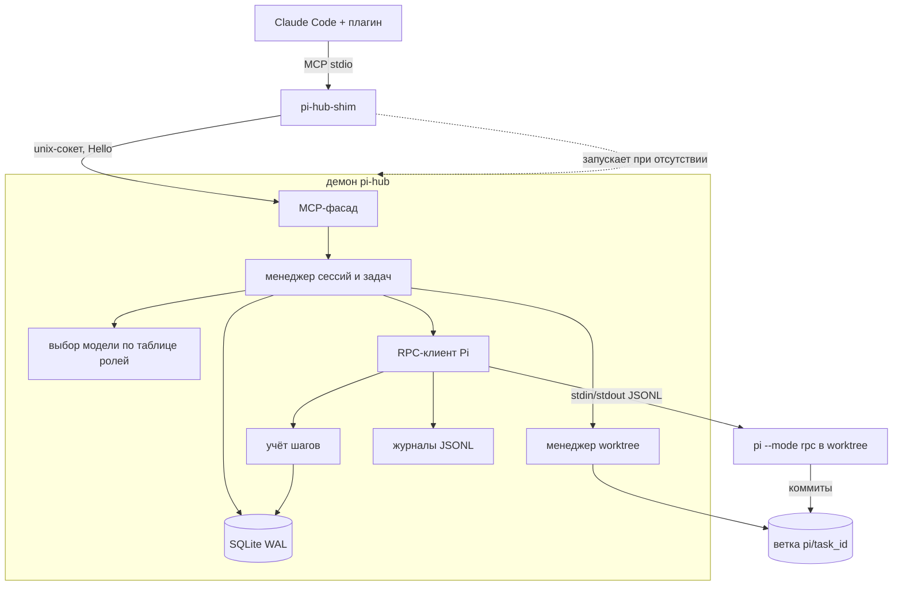

# Specification: Этап 1 — ядро pi-hub на одной машине

**Date:** 2026-11-26
**Priority:** P0
**Type:** New feature (первый этап реализации, MVP)
**Brief:** [PROJECT-BRIEF §9](../brief/PROJECT-BRIEF.md#9-этапы), этап 1 · решения BD-001…BD-019

## 1. Problem

Есть спецификация, архитектура и заготовки модулей, но хаба нет. Старшему агенту в Claude Code некуда передать задачу: никто не запустит Pi на дешёвой модели в изолированной ветке и не вернёт короткую сводку вместо полного хода работы. Дорогая модель старшего по-прежнему тратит токены на исполнение.

## 2. Goal

Пользователь Claude Code включает режим архитектора и передаёт задачу воркеру Pi. Воркер пишет код в отдельном worktree и коммитит в ветку `pi/<task_id>`. Старший получает конверт результата (сводка, допущения, файлы, стоимость) и сливает ветку сам. Всё работает на одной машине.

## 3. Current state

- Каркас монорепо и пакеты-заготовки: `packages/protocol` (статусы и переходы, конверт, схемы инструментов, рукопожатие), `packages/hub/src/*` (интерфейсы модулей без реализации), `packages/shim`, `packages/pi-extension`, `packages/fake-worker`.
- Схема БД: `packages/hub/src/storage/migrations/001_init.sql` — все таблицы спецификации.
- Схема конфига: `packages/hub/src/config/schema.ts`; примеры в `config/`.
- Плагин Claude Code: `plugins/claude-code/` (MCP-сервер через shim, команды `/architect`, `/workers`, скил архитектора, хуки-заготовки).
- Проверено на практике: запуск Pi 1.6.1 в RPC с изолированной конфигурацией и расширением (ADR-0011), диалоги расширения через RPC (ADR-0005).
- Реализации нет ни в одном модуле; тест — только на машину статусов (`packages/hub/test/status.test.ts`).

## 4. User scenarios

### Scenario 1: Делегирование задачи и приёмка (P1)
**As** старший агент в Claude Code, **I want** поручить задачу воркеру и получить короткий итог, **so that** дорогие токены тратятся только на постановку и приёмку.

**Steps:**
1. Пользователь включает режим: `/architect on`.
2. Старший вызывает `start(task, role?, model?, repo, base_branch)`.
3. Хаб создаёт задачу, worktree и ветку `pi/<task_id>` от `base_branch`, выбирает модель и запускает Pi; сразу возвращает `task_id`, статус, модель и причину выбора.
4. Старший вызывает `wait(task_id, timeout)`; хаб держит вызов до завершения задачи или до потолка ожидания.
5. Старший вызывает `result(task_id)` и получает конверт.
6. Старший смотрит дифф ветки и сливает её своими средствами.

**Acceptance criteria (Given / When / Then):**
- [x] Given режим включён и репозиторий в списке разрешённых, when старший вызывает `start`, then ответ приходит не позже 3 с и содержит `task_id`, статус `queued` или `running`, модель и `route_reason`.
- [x] Given задача запущена, when воркер закончил работу (`agent_settled`), then `wait` возвращает статус `done` и однострочную сводку стоимости.
- [x] Given задача `done`, when старший вызывает `result`, then конверт содержит `summary`, `assumptions`, `branch`, `changed_files` (совпадает с `git diff --name-only base...branch`), `quality.status = SKIPPED`, `usage`, `session_total_usd`, `log_path`.
- [x] Given задача `done`, when старший делает `git merge pi/<task_id>`, then все правки воркера уже в коммитах, рабочее дерево worktree чистое.
- [x] Given воркер не закоммитил часть правок, when задача завершилась, then хаб коммитит остаток от имени настроенного пользователя git с сообщением из сводки.
- [x] Given в `.pi-hub.toml` задан `setup`, when задача стартует, then команда выполняется в worktree до запуска Pi; при её ошибке задача `failed`, в `steps` нет ни одной записи.
- [x] Given воркер не изменил ни одного файла, when задача завершилась, then статус `done` и в `warnings` есть «изменений нет».
- [x] Given итог воркера без блока `SUMMARY:`, when задача завершается, then хаб делает ровно один дополнительный запрос и `summary` не пустой.
- [x] Given рабочее дерево основного репозитория «грязное», when вызывается `start`, then задача создаётся, а ответ содержит предупреждение об устаревшей базе.
- [x] Given в любом коммите ветки есть подпись ИИ (`Co-authored-by` с ИИ, «Generated with…»), when задача завершилась, then в поле `warnings` конверта есть предупреждение с хешем коммита.

### Scenario 2: Режим архитектора (P1)
**As** пользователь, **I want** включать делегирование явно, **so that** старший не тратит токены на инструменты pi-hub, пока режим не нужен.

**Steps:**
1. Пользователь открывает сессию Claude Code с установленным плагином.
2. Старший видит только `architect_mode`.
3. Пользователь вводит `/architect on`; хаб включает режим для этой сессии и отправляет `tools/list_changed`.
4. Старший видит 7 инструментов делегирования.
5. `/architect off` запрещает новые задачи.

**Acceptance criteria:**
- [x] Given новая сессия, when клиент запрашивает список инструментов, then в нём ровно один инструмент `architect_mode`.
- [x] Given режим `off`, when поступает вызов любого инструмента делегирования, then хаб отвечает отказом «режим архитектора выключен» и задача не создаётся.
- [x] Given режим включён, when `/architect off` и есть запущенные задачи, then новые `start` отклоняются, а запущенные задачи продолжают работу; ответ `architect_mode` перечисляет их `task_id`.
- [x] Given проект с `delegation = "on"` в `.pi-hub.toml`, when сессия подключается, then режим включён без команды.

### Scenario 3: Наблюдение и отмена (P1)
**As** старший агент, **I want** видеть свои задачи и останавливать их, **so that** я управляю параллельной работой.

**Acceptance criteria:**
- [x] Given у сессии 3 задачи, when вызывается `status`, then возвращаются эти 3 задачи со статусом, моделью, стоимостью на текущий момент и временем работы; задачи других сессий не видны.
- [x] Given задача `running`, when вызывается `cancel`, then процесс Pi останавливается не позже 10 с, статус становится `cancelled`, worktree и ветка сохраняются.
- [x] Given сумма стоимости шагов задачи превысила `max_task_usd`, when записан очередной шаг, then задача останавливается не позже 10 с и получает `failed` с причиной «лимит стоимости».
- [x] Given три `start` в один репозиторий подряд без пауз, when хаб создаёт worktree, then все три задачи стартуют без ошибок блокировок git.
- [x] Given `max_workers = 2` и две задачи `running`, when вызывается третий `start`, then задача получает `queued` и запускается автоматически, как только освобождается слот.

### Scenario 4: Перезапуск хаба и продолжение (P2)
**As** пользователь, **I want** не терять работу воркеров при падении хаба, **so that** задачу можно довести без начала с нуля.

**Acceptance criteria:**
- [x] Given хаб упал при задаче `running`, when хаб стартует снова, then задача получает `interrupted`, `pi_session_path` и worktree сохранены.
- [x] Given задача `interrupted` или `failed`, when старший вызывает `send(task_id, message)`, then хаб поднимает Pi с той же сессией (`switch_session`), передаёт сообщение и задача переходит в `running`.
- [x] Given задача в другом статусе, when вызывается `send`, then хаб отвечает понятным отказом (ответы на вопросы — этап 2).

### Scenario 5: Установка и первый запуск (P1)
**As** пользователь, **I want** поставить pi-hub из репозитория за несколько команд, **so that** можно начать работу без ручной правки конфигов.

**Steps:**
1. `pnpm install && pnpm build && pnpm link --global` — в PATH появляются `pi-hub` и `pi-hub-shim`.
2. `pi-hub init` — создаёт `~/.pi-hub/` (конфиг, `.env` с правами 0600, каталог конфигурации Pi для воркеров), спрашивает провайдера и ключ для модели по умолчанию, разрешённые репозитории; умный роутер — «выкл» (этап 3).
3. `pi-hub init` подключает плагин Claude Code из локальной папки `plugins/claude-code`. Механизм (проверен по документации в фазе 0, PD-011): `claude plugin marketplace add <repo>` + `claude plugin install pi-hub@pi-hub-local --scope user`; если `claude` нет в PATH, `init` печатает эти команды.
4. Пользователь открывает Claude Code; shim сам запускает демон, если тот не работает.

**Acceptance criteria:**
- [x] Given чистая машина с Node ≥ 24, git и Pi 1.6.1, when пользователь выполняет шаги 1–3, then `pi-hub doctor` сообщает: конфиг на месте, ключ задан, Pi нужной версии, расширение воркера находится, Pi видит модель по умолчанию, git доступен.
- [x] Given в окружении демона есть ключи других провайдеров (`OPENAI_API_KEY`, `ANTHROPIC_API_KEY`), when воркер запущен, then в окружении процесса Pi есть только ключ выбранного провайдера.
- [x] Given демон запущен из shim, when пользователь закрывает Claude Code, then демон и задачи `running` продолжают работу.
- [x] Given демон не запущен, when shim стартует, then демон поднимается и shim подключается не позже 3 с; два одновременных shim не запускают два демона.
- [x] Given `pi-hub init` запущен повторно, when пользователь ничего не меняет, then существующие конфиг и `.env` не перезаписываются.
- [x] Given демон недоступен и не стартует, when старший вызывает инструмент, then shim возвращает ошибку «хаб не запущен: см. pi-hub doctor» не позже 5 с, сессия Claude Code не блокируется.

## 5. Functional requirements

### Must Have (P0)
- **FR-001**: Демон `pi-hub serve`: один процесс, unix-сокет `~/.pi-hub/hub.sock` с правами 0600, lock-файл против второго экземпляра. Запущенный из shim демон отвязывается от сессии клиента (новая группа процессов, `cwd` = `~/.pi-hub`) и переживает закрытие Claude Code.
- **FR-002**: Shim `pi-hub-shim`: stdio MCP ↔ сокет хаба, рукопожатие `Hello`/`HelloAck`/`HelloReject` с версией протокола; сам запускает демон, если тот не отвечает (ожидание до 3 с).
- **FR-003**: Хранилище: SQLite в режиме WAL, миграции по `schema_version`; пишет только демон.
- **FR-004**: Старшая сессия создаётся при подключении shim и привязывается к проекту (корень git и remote); ключ — PID родителя (ADR-0007), без `client_session_id` на этом этапе.
- **FR-005**: MCP-фасад: экземпляр сервера на соединение; динамический список инструментов для Claude Code (ADR-0010): при `off` только `architect_mode`, при включении — `list_changed` и 7 инструментов; при `off` вызовы делегирования отклоняет хаб.
- **FR-006**: Режим делегирования: по умолчанию `off`; включение `architect_mode(on|off)` для сессии; проектный `delegation = "on"` в `.pi-hub.toml`.
- **FR-007**: Инструменты `start`, `wait`, `status`, `result`, `cancel`, `send` (только продолжение `interrupted`/`failed`), `architect_mode`; короткие описания.
- **FR-008**: `start` проверяет: режим, репозиторий в `allowed_repos`, существование `base_branch`.
- **FR-009**: Выбор модели: явная `model` → модель роли из таблицы `roles` → модель `default_role`; `routed_by` = `architect` или `rules`, `route_reason` записывается.
- **FR-010**: Менеджер worktree: `git worktree add` с веткой `pi/<task_id>` от `base_branch`; список изменённых файлов относительно базы; worktree не удаляется ни при `done`, ни при `cancel`.
- **FR-011**: Запуск воркера по ADR-0011: свой `PI_CODING_AGENT_DIR`, `-ne -e <расширение pi-hub>`, `-ns -np`, `--no-mcp -na`, `PI_OFFLINE=1`, `--session-dir` хаба, имя сессии = `task_id`, промпт воркера через `--append-system-prompt`. Окружение воркера собирается по белому списку (`PATH`, `HOME`, `LANG`/`LC_*`, `TMPDIR`, переменные Pi, ключ только выбранного провайдера) и не наследуется от демона.
- **FR-012**: RPC-клиент Pi: строгое JSONL-кадрирование (только LF), конец работы по `agent_settled`, корректная остановка (закрыть stdin → SIGTERM → SIGKILL через 10 с).
- **FR-013**: Полный журнал задачи: все события Pi в `logs/<task_id>.jsonl`; секреты из окружения маскируются; каждая запись хаба содержит `task_id` и `senior_session_id`.
- **FR-014**: Машина статусов из `packages/protocol` — единственный способ менять статус; недопустимый переход — ошибка в логе, статус не меняется.
- **FR-015**: Расширение воркера: инструмент `report_assumption(text)`; промпт воркера требует принимать решения самостоятельно, записывать допущения, коммитить правки без подписей ИИ и закончить сводкой.
- **FR-016**: Страховка коммитов: после `agent_settled` хаб коммитит незакоммиченные правки (автор — пользователь git, сообщение — первая строка сводки) и проверяет сообщения коммитов ветки на подписи ИИ.
- **FR-017**: Конверт результата (`ResultEnvelope`, дополняется полем `warnings: string[]`) и однострочная сводка стоимости в ответах `wait` и `result`.
- **FR-018**: Учёт шагов: каждый `message_end` ассистента → строка в `steps` (токены, кэш, стоимость из события Pi, `cost_source = pi_event`, задержка); `usage` в конверте и итог по сессии считаются из `steps`.
- **FR-019**: `wait`: длинный опрос с потолком по клиенту (`clients.claude-code.max_wait_sec = 1500`), progress-уведомление раз в 60 с; по истечении — текущий статус.
- **FR-020**: Параллельные задачи с лимитом `limits.max_workers_hub` (по умолчанию 2); лишние — `queued`, запуск по освобождению слота в порядке создания.
- **FR-021**: Потолок длительности задачи `limits.max_task_minutes` (по умолчанию 60): по истечении задача останавливается и получает `failed` с причиной.
- **FR-022**: Восстановление после старта демона: задачи `running`/`planning`/`checking` с мёртвым процессом → `interrupted`; `queued` запускаются заново.
- **FR-023**: Продолжение: `send` для `interrupted`/`failed` поднимает Pi с той же сессией и передаёт сообщение.
- **FR-024**: Подготовка worktree: если в `.pi-hub.toml` задана команда `setup` (например, `pnpm install --frozen-lockfile`), хаб выполняет её в worktree до запуска Pi; при ошибке задача получает `failed` с выводом первых ошибок, модель не вызывается.
- **FR-025**: Предел стоимости задачи `limits.max_task_usd` (по умолчанию 2 $): по сумме `steps` при превышении задача останавливается и получает `failed` с причиной «лимит стоимости».
- **FR-026**: Итог воркера: промпт требует закончить блоком `SUMMARY:`; если его нет, хаб один раз отправляет воркеру короткий `follow_up` с просьбой написать итог в заданном формате (учитывается как шаг), затем берёт текст и обрезает до 500 символов.
- **FR-027**: Предупреждения о качестве итога: пустой дифф относительно базы → `warnings: «изменений нет»`; признаки незавершённости в итоге (`TODO`, «не успел», «частично») → предупреждение; статус при этом `done`.
- **FR-028**: Операции git в одном репозитории (`worktree add`, авто-коммит, очистка) выполняются последовательно под блокировкой хаба на репозиторий.
- **FR-029**: Устаревшая база: если рабочее дерево основного репозитория содержит незакоммиченные правки или `base_branch` не совпадает с текущим `HEAD`, ответ `start` содержит предупреждение; задача при этом создаётся.

### Should Have (P1)
- **FR-030**: `pi-hub init`: создаёт `~/.pi-hub/` (конфиг, `.env` 0600, каталог конфигурации Pi воркеров), спрашивает провайдера, модель по умолчанию, ключ и разрешённые репозитории; не перезаписывает существующее; подключает плагин Claude Code из локальной папки.
- **FR-031**: `pi-hub doctor`: проверяет конфиг, ключ провайдера, версию Pi против закреплённой, наличие расширения, git, доступность сокета демона и то, что Pi с изолированной конфигурацией видит модель по умолчанию (`get_available_models` по RPC, без вызова модели). Та же проверка — последний шаг `pi-hub init`.
- **FR-032**: Плагин Claude Code: `/architect on|off`, `/workers` (список задач сессии), скил архитектора с правилом «если `wait` вернул `running` — снова `wait`».
- **FR-033**: Фейковый воркер со сценариями `success`, `crash`, `hang`, совместимый с подмножеством RPC Pi, которое использует хаб; хаб переключается на него конфигом.

### Nice to Have (P2)
- **FR-040**: `pi-hub status` в терминале: задачи всех сессий (для человека, без токена администратора на этом этапе).

## 6. Non-functional requirements

- **Performance**: ответ `start`, `status`, `result`, `cancel`, `architect_mode` — не дольше 1 с без учёта запуска процесса Pi (`start` — не дольше 3 с). Shim отвечает на `initialize` не дольше 1 с, даже если демон ещё стартует.
- **Security**: сокет 0600; ключи только в `~/.pi-hub/.env` и окружении процесса Pi (по белому списку, FR-011), никогда в БД, логах, конфиге плагина; задачи только в `allowed_repos`; никакого TCP-порта на этом этапе.
- **Reliability**: падение процесса Pi не роняет демон (задача → `failed`); падение демона не теряет задачи (→ `interrupted`); недоступный демон не блокирует сессию Claude Code.
- **Compatibility**: macOS и Linux; Node ≥ 24; Pi 1.6.1 (закреплён); Claude Code с поддержкой плагинов и `list_changed`; git ≥ 2.40. Длина пути сокета ≤ 100 байт.
- **Testability**: все сценарии, кроме реального запуска модели, проверяются интеграционными тестами на фейковом воркере без сети.

## 7. Data model (conceptual)

Используется существующая схема `001_init.sql`; новых таблиц нет.

```
SeniorSession: id, client=claude-code, parent_pid, project, mode, connected_at, last_seen_at
Project: id, repo_root, remote_url, default_mode
Task: id (t_NNNN), owner → SeniorSession, project → Project, status, role, model,
      routed_by, route_reason, worktree_path, branch, pi_session_path, log_path,
      summary, quality_status=SKIPPED, pid, created_at, finished_at
Step: task → Task, seq, model, provider, input/output/cache tokens, cost, cost_source=pi_event, latency
Assumption: хранится в журнале задачи и конверте [ASSUMPTION: отдельная таблица не нужна до этапа 2]
```

Не используются на этом этапе: `questions`, `prices`, `tokens`.

## 8. User interface

Интерфейса нет. Точки взаимодействия:

```
Claude Code:  /architect on|off   /workers   (инструменты pi-hub в разговоре)
Терминал:     pi-hub init | serve | doctor | status
Файлы:        ~/.pi-hub/config.yaml  ~/.pi-hub/.env  ~/.pi-hub/logs/<task_id>.jsonl
```

Однострочная сводка стоимости: `0,043 $ · 182k вход (71% из кэша) · 9k выход · 6 мин · SKIPPED · по сессии 0,31 $`.

## 9. Architecture (overview)



## 10. Out of scope

- Вопросы воркера: инструмент `ask`, ответы через `send`, фаза `clarify`, статус `needs_input`, подвал ответов, хук Stop, консультант — **этап 2**.
- Проверка качества (тесты, линтер, типы): `quality.status` всегда `SKIPPED` — **этап 2**.
- Бюджеты и квоты по деньгам, импорт цен из каталога Pi, `usage_report` — **этап 2**.
- Fallback, эскалация, System One, умный роутер в `init` — **этап 3**.
- Codex (профиль, статический список инструментов) — **этап 3**.
- Хук SessionStart и `client_session_id`, сироты, `adopt`, `/workers all`, токены клиентов и администратора, блокировка сборки, проверка конфликтов между ветками — **этап 4**.
- Удалённая работа (ssh-stdio, HTTP) — **этап 4**.
- Веб-панель, аналитика — **этап 5**.
- Публикация в npm и marketplace плагинов.
- Автоматическое слияние веток: сливает старший.
- Автоочистка worktree: на этапе 1 worktree не удаляются; команда очистки слитых веток — этап 4 (вместе с блокировкой сборки).

## 11. Deferred questions

| Question | Why deferred | When the answer is needed | Who decides |
|----------|--------------|---------------------------|-------------|
| — | — | — | — |

## 12. Spec decisions

| # | Question | Decision | Date |
|---|----------|----------|------|
| D-001 | Кто запускает демон | Shim сам: если сокет не отвечает, запускает `pi-hub serve` в фоне и ждёт до 3 с; lock-файл против двойного запуска. Без настройки служб ОС; цена — чуть сложнее shim | 2026-11-26 |
| D-002 | Выбор модели без роутинга этапа 3 | Явная `model` → модель роли → модель `default_role`; без fallback, эскалации и System One. Конфиг сразу в итоговом формате | 2026-11-26 |
| D-003 | Учёт на этапе 1 | Запись шагов из `message_end` Pi и `usage` в конверте; бюджеты, импорт цен и отчёты — этап 2. Стоимость видна с первой реальной задачи | 2026-11-26 |
| D-004 | Кто коммитит | Воркер коммитит сам по промпту; после завершения хаб коммитит остатки и проверяет подписи ИИ в сообщениях, при нарушении — запись в `warnings` конверта. Сохраняется разбиение на шаги, ветка всегда полная | 2026-11-26 |
| D-005 | Установка | Из репозитория: `pnpm build` + `pnpm link --global`, `pi-hub init` подключает плагин из локальной папки. Без npm и marketplace до стабилизации | 2026-11-26 |
| D-006 | Параллельность | Несколько задач с лимитом `max_workers_hub` (по умолчанию 2), остальные `queued`; конфликты при слиянии решает старший (проверка конфликтов — этап 4) | 2026-11-26 |
| D-007 | Прерванные задачи | `interrupted` + продолжение через `send` той же сессией Pi; `send` на этапе 1 только для `interrupted`/`failed` | 2026-11-26 |
| D-008 | Идентификация сессии | Только PID родителя; хук SessionStart и `client_session_id` — этап 4 вместе с сиротами. Одна сессия Claude Code = один shim = одна старшая сессия | 2026-11-26 |
| D-009 | Зависший воркер | Потолок длительности задачи `max_task_minutes` (60) → `failed`; умное обнаружение зависания — этап 3 | 2026-11-26 |
| D-010 | Источник `summary` и `assumptions` | `summary` — финальное сообщение воркера (`get_last_assistant_text`), обрезанное до 500 символов; `assumptions` — вызовы `report_assumption` | 2026-11-26 |
| D-011 | Предсмертный разбор: зависимости в свежем worktree | Команда `setup` из `.pi-hub.toml` до запуска Pi (FR-024) | 2026-11-26 |
| D-012 | Предсмертный разбор: утечка ключей и окружения | Окружение воркера по белому списку, демон отвязан от сессии клиента (FR-001, FR-011) | 2026-11-26 |
| D-013 | Предсмертный разбор: расход без бюджетов | Жёсткий предел стоимости задачи 2 $ по умолчанию; полноценные бюджеты — этап 2 (FR-025) | 2026-11-26 |
| D-014 | Предсмертный разбор: плохая сводка и пустой результат | Обязательный блок `SUMMARY:` с одним досрочным запросом, предупреждения о пустом диффе и незавершённости (FR-026, FR-027) | 2026-11-26 |
| D-015 | Предсмертный разбор: гонки git и устаревшая база | Блокировка git-операций на репозиторий; предупреждение о грязном дереве и расхождении с HEAD (FR-028, FR-029) | 2026-11-26 |
| D-016 | Предсмертный разбор: Pi не видит модель, плагин не подключается | Проверка модели через RPC в `doctor` и `init` (FR-031); автоподключение плагина помечено как допущение с ручным запасным путём | 2026-11-26 |

## 13. Success criteria

- [x] Ворота этапа 1 пройдены: реальная задача на реальном Pi и дешёвой модели проходит путь `/architect on` → `start` → `wait` → `result` → `git merge` в тестовом репозитории.
- [x] Интеграционные тесты на фейковом воркере покрывают сценарии 1–4 (успех, отмена, падение воркера, зависание, перезапуск демона, очередь при лимите) и проходят без сети.
- [ ] `pnpm build`, `pnpm lint`, `pnpm test` зелёные в CI.
- [x] Конверт результата занимает не более 2 КБ для задачи с 20 изменёнными файлами — старший читает только его.
- [x] Ни одного ключа провайдера в БД, журналах и файлах плагина (проверка поиском по каталогу `~/.pi-hub` и репозиторию после тестового прогона).
