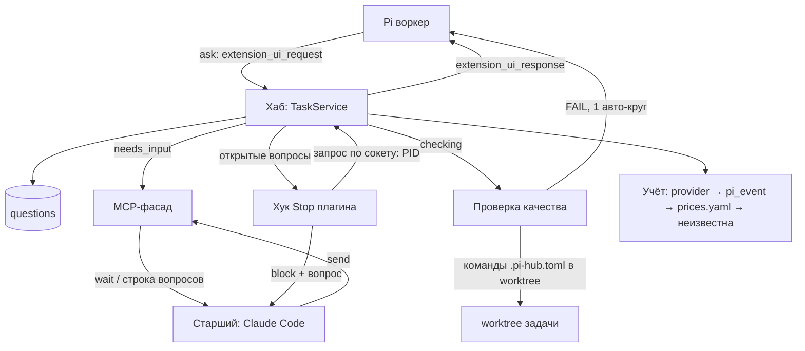

# Specification: Этап 2 — вопросы воркера и проверка качества

**Date:** 2026-11-27
**Priority:** P1
**Type:** Extension (второй этап реализации поверх этапа 1)
**Brief:** [PROJECT-BRIEF §9](../brief/PROJECT-BRIEF.md#9-этапы), этап 2 · решения BD-001…BD-023
**Предыдущий этап:** [2026-11-26-stage-1-core.md](2026-11-26-stage-1-core.md) (требования FR-001…FR-040). Требования этого этапа нумеруются с FR-101, чтобы не путать их с требованиями этапа 1.

## 1. Problem

Воркер этапа 1 не может спросить: всё неясное он решает сам или делает неверно, и старший узнаёт об этом только из итога. Проверки качества нет: у каждой задачи вердикт `SKIPPED`, и старший принимает работу, не зная, проходят ли тесты. Вернуть завершённую задачу на доработку нельзя: `send` работает только для `interrupted` и `failed`. Стоимость показывается только тогда, когда Pi знает цену модели; для провайдеров из расширений без цен (`9router`) она равна 0 $ без пометки, что цена неизвестна. Пределы стоимости и длительности задачи включены по умолчанию и могут остановить работу, которую пользователь хотел довести до конца.

## 2. Goal

Воркер останавливается на важном вопросе, и вопрос гарантированно доходит до старшего: через `wait`, через строку в ответе любого инструмента и через хук Stop в Claude Code. Старший отвечает через `send`, и воркер продолжает в той же сессии Pi. Каждый результат приходит с вердиктом PASS, FAIL или SKIPPED по командам проекта; мелкие ошибки воркер исправляет сам до того, как их увидит старший. Стоимость — справка, а не ограничение: она показывается, если её можно вычислить, и честно помечается, если нельзя.

## 3. Current state

- **Расширение воркера** `packages/pi-extension/src/index.ts`: только `report_assumption`. Промпт `worker-prompt.md` запрещает задавать вопросы.
- **Канал вопросов проверен** (ADR-0005, ADR-0011): `ctx.ui.select`/`input` расширения приходят хабу как `extension_ui_request`, ответ `extension_ui_response` возвращается в расширение. Хаб распознаёт событие (`pi-rpc/events.ts`, вид `ui_request`) и умеет писать ответ (`PiRpcClient` — запись без ответа на команду), но никак его не обрабатывает. Проверено в Pi 1.6.1 (`modes/rpc/rpc-mode.js`): таймаут диалога задаётся только явно, по умолчанию его нет — вопрос может ждать старшего сколько угодно.
- **Статусы** `packages/protocol/src/status.ts`: `planning` и `needs_input` уже есть, переходы `running → needs_input → running` разрешены; `done` — конечный.
- **Хранилище**: таблица `questions` (раунд, текст, варианты, ответ, кто ответил) и таблица `prices` есть в `001_init.sql`, но не используются.
- **Проверка качества**: только интерфейс `quality/quality-gate.ts`; финализация (`tasks/worker-runner.ts`) всегда пишет `SKIPPED`. Команды `quality.test/lint/typecheck` уже описаны в схеме `.pi-hub.toml` (`config/schema.ts`) и в `config/pi-hub.project.example.toml`.
- **Фасад** `facade/mcp-facade.ts`: `send` вызывает `TaskService.send`, который принимает только `interrupted`/`failed`. Строки об ожидающих вопросах в ответах нет.
- **Учёт** `accounting/accounting.ts`: стоимость из `message_end` Pi (`cost_source` = `provider` или `pi_event`), строка стоимости `formatCostLine`. Ручных цен нет; нулевая стоимость не отличается от неизвестной.
- **Пределы**: `limits.max_task_usd` (2 $) и `limits.max_task_minutes` (60) — `config/schema.ts`, проверка в `worker-runner.ts`.
- **Плагин Claude Code** `plugins/claude-code/`: хуков нет (удалены на этапе 1), скил архитектора без правил о вопросах и FAIL.
- **Рукопожатие** shim ↔ хаб (`packages/protocol/src/hub-wire.ts`): только MCP-соединение; отдельного короткого запроса (для хука) нет.

## 4. User scenarios

### Scenario 1: Вопрос воркера, старший ждёт в `wait` (P1)
**As** старший агент, **I want** получать вопрос воркера сразу, пока жду результат, **so that** воркер не гадает в важных решениях.

**Steps:**
1. Воркер упирается в решение о схеме данных и вызывает `ask` с текстом и вариантами «A: Redis, B: таблица в БД».
2. Хаб записывает вопрос, переводит задачу в `needs_input`; воркер стоит и не тратит токены.
3. `wait` старшего сразу возвращает `needs_input` с текстом вопроса и вариантами.
4. Старший отвечает `send(task_id, "B, таблица sessions")`; задача возвращается в `running`, воркер получает ответ как результат `ask` и продолжает.
5. Результат: итог задачи учитывает ответ; в журнале вопросов есть вопрос, ответ и `answered_by = senior`.

**Acceptance criteria (Given / When / Then):**
- [x] Given старший висит в `wait` по задаче, when воркер вызвал `ask`, then `wait` возвращается не позже чем через 2 с со статусом `needs_input`, текстом вопроса и вариантами.
- [x] Given задача в `needs_input`, when старший вызвал `send` с ответом, then задача переходит в `running`, воркер получает текст ответа как результат `ask`, и в `questions` записаны `answer`, `answered_by = senior`, `answered_at`.
- [x] Given задача в `needs_input` 30 минут, when старший не отвечает, then задача остаётся в `needs_input`, новых шагов в `steps` нет и потолок длительности (если включён) не отсчитывает это время.
- [x] Given задача в `needs_input`, when демон перезапустился, then задача становится `interrupted`, вопрос остаётся открытым, а `send` с ответом продолжает ту же сессию Pi, передав воркеру вопрос и ответ текстом.
- [x] Given задача в `needs_input`, when старший вызвал `cancel`, then задача `cancelled`, вопрос закрыт без ответа.
- [x] Given воркер не вызвал `ask`, а закончил работу итогом без блока `SUMMARY:`, последний абзац которого заканчивается вопросительным знаком, when хаб финализирует задачу, then задача переходит в `needs_input` с этим абзацем как вопросом (`kind = text`), а не в `done`; `send` продолжает ту же сессию Pi.

### Scenario 2: Вопрос, пока старший занят другим (P1)
**As** старший агент, работающий с несколькими задачами, **I want** узнавать об ожидающих вопросах из любого ответа хаба и не заканчивать ход, пока вопрос висит, **so that** воркер не простаивает часами.

**Steps:**
1. Старший запустил две задачи и вызывает `status` или `wait` по другой задаче.
2. К ответу любого инструмента хаба добавляется строка «ожидают ответа: t_0142 (1 вопрос)».
3. Старший собирается закончить ход, не ответив. Хук Stop плагина спрашивает хаб и не даёт остановиться, передав текст вопроса.
4. Старший отвечает через `send`.

**Acceptance criteria (Given / When / Then):**
- [x] Given у сессии есть задача в `needs_input`, when старший вызывает любой инструмент хаба, then ответ содержит строку с идентификаторами задач и числом открытых вопросов; без открытых вопросов строки нет.
- [x] Given у сессии есть открытый вопрос и режим `on`, when Claude Code заканчивает ход, then хук Stop блокирует остановку и передаёт старшему задачу, текст вопроса и варианты.
- [x] Given хук уже один раз заблокировал остановку из-за этого вопроса, when старший снова заканчивает ход без ответа, then хук не блокирует повторно (строка в ответах инструментов остаётся).
- [x] Given хаб не запущен, сокет недоступен или режим `off`, when срабатывает хук Stop, then он завершается не дольше чем за 100 мс, ничего не блокирует и пишет причину в лог хука.
- [x] Given две сессии Claude Code в одном репозитории, when у задачи первой сессии открыт вопрос, then хук и строка в ответах второй сессии его не показывают.
- [x] Given по предкам процесса хука сессия не найдена, а в этом проекте ровно одна подключённая сессия Claude Code, when срабатывает хук, then хаб использует её; при двух и более таких сессиях хук ничего не блокирует и пишет в лог «сессия хука не определена».

### Scenario 3: Сначала план, потом работа — `clarify` (P2)
**As** старший агент, **I want** для задачи проектирования сначала увидеть план воркера и его вопросы, **so that** не переделывать работу, начатую с неверных допущений.

**Steps:**
1. Старший вызывает `start(..., clarify: true)`.
2. Задача начинается в `planning`: воркер читает код, ничего не меняет и завершает фазу одним `ask` с планом и вопросами.
3. `wait` возвращает `needs_input` с планом и вопросами.
4. Старший отвечает через `send` (ответы на вопросы, поправки к плану); задача переходит в `running` в той же сессии Pi.

**Acceptance criteria (Given / When / Then):**
- [x] Given `start` с `clarify: true`, when воркер закончил разбор, then задача в `needs_input`, вопрос содержит план, а в worktree нет изменений и коммитов относительно базы.
- [x] Given задача ждёт ответа на план, when старший вызвал `send`, then статус переходит `needs_input → running` и воркер продолжает в той же сессии Pi.
- [x] Given `clarify: true`, when воркер в фазе `planning` изменил файлы, then хаб не прерывает фазу, но в ответ на план добавляет предупреждение «в фазе плана изменены файлы».

### Scenario 4: Проверка качества и доработка (P1)
**As** старший агент, **I want** получать вердикт по тестам, линтеру и типам, а мелкие ошибки — уже исправленными, **so that** читать только итог и замечания по существу.

**Steps:**
1. Воркер закончил работу; задача переходит в `checking`.
2. Хаб выполняет в worktree команды `quality.test`, `quality.lint`, `quality.typecheck` из `.pi-hub.toml`.
3. Если есть ошибки, хаб один раз отдаёт воркеру замечания в той же сессии Pi и проверяет снова.
4. Конверт приходит с вердиктом и короткими замечаниями. При FAIL или своих замечаниях старший возвращает задачу через `send`; воркер дорабатывает в той же ветке, проверка повторяется.

**Acceptance criteria (Given / When / Then):**
- [x] Given в `.pi-hub.toml` заданы команды проверки и все завершились с кодом 0, when воркер закончил, then конверт содержит `quality.status = PASS` и пустой `issues`.
- [x] Given первая проверка упала, when хаб вернул замечания воркеру и повторная проверка прошла, then конверт `PASS`, а в `warnings` есть «проверка прошла со второй попытки».
- [x] Given обе проверки упали, then задача `done` с `quality.status = FAIL`, `issues` содержит не больше 10 строк не длиннее 200 символов каждая с указанием команды, а полный вывод лежит в файле, путь к которому есть в конверте.
- [x] Given в `.pi-hub.toml` нет ни одной команды проверки, then конверт `SKIPPED` с замечанием «команды проверки не заданы в .pi-hub.toml».
- [x] Given задача `done` (PASS или FAIL), when старший вызвал `send` с замечаниями, then задача проходит `done → running` в той же сессии Pi и той же ветке, после чего снова идёт проверка и формируется новый конверт; `attempt` увеличивается.
- [x] Given две задачи одного проекта закончили работу одновременно, then их проверки выполняются по очереди, а не параллельно.
- [x] Given команда проверки работает дольше `quality.timeout_minutes`, then она останавливается вместе с дочерними процессами и считается упавшей с замечанием «превышено время».
- [x] Given команда проверки падает и на коммите базы задачи, when проверка задачи тоже падает на этой команде, then вердикт `FAIL`, замечание «падало до задачи: <команда>», авто-круг для этой команды не запускается; результат проверки базы считается один раз на коммит базы и переиспользуется другими задачами.
- [x] Given проверка базы прошла, а проверка задачи упала, then это новая ошибка: авто-круг запускается как обычно.
- [x] Given в диффе задачи относительно базы удалён файл теста или добавлены пометки пропуска теста (`.skip`, `.only`, `xit`, `@pytest.mark.skip`, `t.Skip`), then в `warnings` конверта есть «изменены или отключены тесты: <файлы>», даже при `PASS`.
- [x] Given ветка задачи уже слита в базовую ветку, when старший вызвал `send` на `done`, then ответ содержит предупреждение «ветка уже слита: новые коммиты нужно слить заново».

### Scenario 5: Стоимость как справка (P1)
**As** пользователь, **I want** спросить старшего, сколько стоила работа, и получить честный ответ, **so that** понимать расходы без лимитов, которые мешают закончить работу.

**Steps:**
1. Воркер работает; каждый шаг модели записывается в учёт.
2. В ответах `wait` и `result` строка стоимости: сумма, токены, доля кэша, время, вердикт, итог по сессии.
3. Если цена модели неизвестна, строка говорит «цена неизвестна» и показывает токены.

**Acceptance criteria (Given / When / Then):**
- [x] Given провайдер вернул стоимость в ответе, then шаг записан с `cost_source = provider` и этой суммой.
- [x] Given провайдер не вернул стоимость, но Pi посчитал её по своему каталогу, then `cost_source = pi_event`.
- [x] Given стоимость в событии нулевая и для модели есть ручная цена в `~/.pi-hub/prices.yaml`, then стоимость = токены × цена, `cost_source = tokens_x_price`, и цена на момент шага сохранена в шаге.
- [x] Given цену получить неоткуда, then шаг помечен как «цена неизвестна», строка стоимости выводит «цена неизвестна» вместо суммы, а итог по сессии помечен «без учёта N шагов с неизвестной ценой».
- [x] Given конфиг без `limits.max_task_usd` и `limits.max_task_minutes`, when задача работает дольше 60 минут и дороже 2 $, then хаб её не останавливает.
- [x] Given пользователь задал `limits.max_task_usd` или `limits.max_task_minutes`, then превышение останавливает задачу как на этапе 1.

## 5. Functional requirements

### Must Have (P0)
- **FR-101**: Инструмент воркера `ask(question, options?)` в расширении pi-hub: вызывает диалог Extension UI (ADR-0005), блокируется до ответа и возвращает модели текст ответа. Ответ старшего передаётся как есть: варианты — подсказка, а не ограничение.
- **FR-102**: Хаб обрабатывает запрос диалога расширения: записывает вопрос в `questions` (раунд, текст, варианты, время), переводит задачу `planning|running → needs_input`, будит ожидающий `wait`. Диалоги расширения, которые не являются вопросом pi-hub, хаб отклоняет ответом-отказом и пишет в журнал.
- **FR-103**: `wait` на `needs_input` возвращается сразу: статус, `task_id`, текст вопроса, варианты, номер раунда. Пока задача в `needs_input`, повторный `wait` возвращает тот же вопрос без ожидания.
- **FR-104**: `send` для `needs_input` — ответ на открытый вопрос: ответ уходит воркеру как результат `ask`, вопрос закрывается (`answer`, `answered_by = senior`, `answered_at`), задача возвращается в статус, из которого спросила (`planning` или `running`).
- **FR-105**: `send` для `done` — доработка: та же сессия Pi, та же ветка и worktree, сообщение старшего уходит воркеру, затем финализация и проверка качества заново; `attempt` увеличивается. Машина статусов дополняется переходом `done → running`. `done` остаётся «готово к слиянию», но перестаёт быть необратимым.
- **FR-106**: Открытый вопрос переживает перезапуск демона: задача становится `interrupted`, вопрос остаётся открытым; `send` поднимает ту же сессию Pi и передаёт воркеру текстом «вопрос: … ответ: …».
- **FR-107**: Строка ожидающих вопросов: к ответу любого инструмента хаба для сессии добавляется строка вида «ожидают ответа: t_0142 (1 вопрос), t_0145 (1 вопрос)», если у задач этой сессии есть открытые вопросы. Не длиннее 300 байт; при большем числе задач — первые пять и «и ещё N».
- **FR-108**: Короткий запрос хука к хабу: отдельный тип запроса по сокету (не MCP) — «открытые вопросы сессии для процесса с PID N». Хаб сопоставляет процесс со старшей сессией, поднимаясь по предкам процесса до PID родителя известной сессии. Изменение протокола shim ↔ хаб — с повышением `PROTOCOL_VERSION`.
- **FR-109**: Хук Stop в плагине Claude Code: тонкий скрипт, без логики и ключей. Спрашивает хаб (FR-108) и при открытых вопросах блокирует завершение хода, передавая задачу, текст вопроса и варианты. Один и тот же вопрос блокирует остановку не больше одного раза; хаб помечает вопрос как доставленный хуком.
- **FR-110**: Хук никогда не мешает старшему при сбое: ответ не дольше 100 мс; при ошибке, недоступном хабе или режиме `off` — пропуск без блокировки и запись в `~/.pi-hub/logs/hooks.log`.
- **FR-111**: Проверка качества: после работы воркера (статус `checking`) хаб выполняет в worktree заданные в `.pi-hub.toml` команды `quality.test`, `quality.lint`, `quality.typecheck` по очереди целиком (не по списку файлов). Окружение команд — по белому списку, без ключей провайдеров (как `setup` на этапе 1). Каждая команда ограничена `quality.timeout_minutes` (по умолчанию 15), по таймауту останавливается вся группа процессов.
- **FR-112**: Вердикт: все команды с кодом 0 → `PASS`; хотя бы одна упала или превысила время → `FAIL`; команд нет → `SKIPPED` с замечанием. Полный вывод — в `logs/<task_id>.quality.log`; в конверт идут `issues`: до 10 строк до 200 символов, с именем команды.
- **FR-113**: Один авто-круг исправления: при первом `FAIL` хаб отправляет воркеру в той же сессии Pi короткое сообщение с `issues` и путём к полному выводу, ждёт завершения и проверяет снова. Второй `FAIL` — итоговый. Авто-круг учитывается в шагах и стоимости задачи.
- **FR-114**: Проверки одного проекта выполняются последовательно (блокировка хаба на проект); задачи разных проектов проверяются параллельно.
- **FR-115**: Промпт воркера: «решай сам и вызывай `report_assumption`» для некритичного; `ask` — только для схемы данных, публичного API, удаления данных и файлов, выбора внешней зависимости и противоречий в задаче. Не больше одного `ask` за раз.
- **FR-116**: Стоимость шага по источникам, по убыванию точности: стоимость от провайдера (`provider`) → стоимость Pi по его каталогу (`pi_event`) → токены × ручная цена из `~/.pi-hub/prices.yaml` (`tokens_x_price`) → «цена неизвестна». Нулевая стоимость в событии считается неизвестной (BD-016). Цена на момент шага сохраняется в шаге.
- **FR-117**: Строка стоимости и итог по сессии различают «0 $» и «цена неизвестна»; итог по сессии с неизвестными шагами помечается «без учёта N шагов с неизвестной ценой».
- **FR-118**: Пределы задачи `limits.max_task_usd` и `limits.max_task_minutes` по умолчанию не заданы. Если пользователь их задал — поведение этапа 1 (FR-021, FR-025). Потолок длительности не отсчитывает время в `needs_input`.
- **FR-119**: Проверка базы: перед первой проверкой задачи хаб выполняет те же команды на коммите базы задачи (во временном worktree) и запоминает результат для пары «проект + коммит базы». Команда, падающая и на базе, даёт замечание «падало до задачи» и не запускает авто-круг; авто-круг — только для новых ошибок. Вердикт при этом остаётся `FAIL`, если команда падает.
- **FR-120**: Вопрос текстом: если воркер закончил работу итогом без `SUMMARY:` и последний абзац итога заканчивается «?», хаб не завершает задачу, а оформляет этот абзац как открытый вопрос (`kind = text`) со статусом `needs_input`. Ответ через `send` уходит воркеру обычным сообщением в той же сессии Pi. Досрочная просьба написать итог (FR-026 этапа 1) в этом случае не отправляется.
- **FR-121**: Защита тестов: промпт воркера запрещает удалять, отключать и ослаблять тесты, чтобы пройти проверку. Хаб после работы воркера ищет в диффе относительно базы удалённые файлы тестов и добавленные пометки пропуска (`.skip`, `.only`, `xit`, `xdescribe`, `@pytest.mark.skip`, `t.Skip`) и пишет предупреждение в `warnings` независимо от вердикта.
- **FR-122**: Запасной путь хука: если по предкам процесса сессия не найдена, хаб берёт единственную подключённую сессию Claude Code этого проекта (по `cwd` хука); если таких сессий несколько или ни одной — хук не блокирует и пишет причину в лог.
- **FR-123**: `send` на `done`, ветка которого уже слита в базовую ветку, выполняется, но ответ содержит предупреждение «ветка уже слита: новые коммиты нужно слить заново».

### Should Have (P1)
- **FR-125**: `clarify` в `start`: задача начинается в `planning`; промпт фазы плана запрещает правки файлов и требует закончить фазу одним `ask` с планом и вопросами. Ответ через `send` переводит задачу в `running` в той же сессии Pi. Если в фазе плана изменились файлы — предупреждение в вопросе.
- **FR-126**: Скил архитектора: на `needs_input` ответить через `send` (или спросить пользователя, если решение за ним); при `FAIL` вернуть задачу через `send` с замечаниями; не заканчивать ход с открытыми вопросами; после каждого шага одной фразой сообщить пользователю стоимость.
- **FR-127**: Конверт результата дополняется полями `quality.issues`, `quality.log_path`, `questions` (число вопросов и ответов за задачу) и `attempt`; размер конверта по-прежнему не больше 2 КБ для задачи с 20 файлами.
- **FR-128**: `pi-hub doctor` проверяет плагин: хук Stop установлен и отвечает; и показывает для моделей ролей источник цены (провайдер, каталог Pi, ручная, неизвестна).
- **FR-129**: Фейковый воркер получает сценарии `ask` (один вопрос, ждёт ответ, продолжает), `ask-twice`, `clarify` (план-вопрос без правок), `quality-fix` (первый результат ломает тест, после замечаний исправляет), `quality-broken` (не исправляет), `text-question` (итог с вопросом без `SUMMARY:`), `skip-test` (отключает упавший тест).

### Nice to Have (P2)
- **FR-130**: `pi-hub status` показывает задачи в `needs_input` с текстом вопроса (первые 80 символов) и временем ожидания.

## 6. Non-functional requirements

- **Скорость доставки**: от вызова `ask` воркером до возврата `wait` — не больше 2 с.
- **Хук**: ответ не дольше 100 мс в 95 % вызовов, включая запуск процесса; никогда не блокирует старшего при сбое.
- **Токены старшего**: строка ожидающих вопросов ≤ 300 байт, конверт ≤ 2 КБ, `issues` ≤ 10 строк по 200 символов; описания новых параметров инструментов — одна короткая фраза.
- **Безопасность**: команды проверки и хук не получают ключей провайдеров; хук не содержит логики и ключей (принцип 1 брифа); текст вопроса и ответа маскируется в журналах так же, как остальные записи.
- **Совместимость**: shim и хаб разных версий протокола получают понятный отказ (`HelloReject`), как на этапе 1; хук без ответа хаба пропускает ход.

## 7. Data model (conceptual)

```
Вопрос (questions — таблица есть с этапа 1)
  - задача → Задача
  - раунд: номер вопроса в задаче
  - вид: plan (фаза clarify) | question (через ask) | text (вопрос в итоге, FR-120)
  - текст, варианты
  - ответ, кто ответил (senior), когда
  - доставлен хуком: время первой блокировки остановки (новое)
  - id диалога Pi: для ответа воркеру (новое)

Задача (tasks)
  - attempt: номер круга доработки (есть с этапа 1)
  - quality_status, quality_issues (новое), quality_log_path (новое)
  - статус, из которого задан вопрос (новое): planning | running

Шаг учёта (steps)
  - cost_source: provider | pi_event | tokens_x_price | unknown (новое значение)
  - цена на момент шага (новое, при tokens_x_price)

Результат проверки базы (новое)
  - проект, коммит базы, по каждой команде: код выхода, время

Ручная цена (~/.pi-hub/prices.yaml, файл, не БД)
  - провайдер, модель, вход, выход, кэш-чтение, кэш-запись (USD за 1M токенов)
```

Таблица `prices` в БД на этом этапе не нужна: Pi сам считает стоимость по своему каталогу, ручные цены лежат в файле.

## 8. User interface

Экранов нет; всё в ответах инструментов и в хуке.

```
wait → needs_input
  { status: "needs_input", task_id: "t_0142", round: 1,
    question: "Где хранить сессии?", options: ["A: Redis", "B: таблица в БД"] }
  ожидают ответа: t_0142 (1 вопрос)

result → done, FAIL
  quality: { status: "FAIL", issues: ["test: register.test.ts › отклоняет короткий пароль"],
             log_path: "~/.pi-hub/logs/t_0142.quality.log" }
  0,043 $ · 182k вход (71% из кэша) · 9k выход · 6 мин · FAIL · по сессии 0,31 $

строка стоимости без цены
  цена неизвестна · 182k вход (71% из кэша) · 9k выход · 6 мин · PASS · по сессии 0,12 $ (без учёта 3 шагов)

хук Stop (причина блокировки, видит старший)
  Воркер t_0142 ждёт ответа: «Где хранить сессии?» Варианты: A: Redis; B: таблица в БД.
  Ответьте через send(t_0142, …) или спросите пользователя.
```

## 9. Architecture (overview)



## 10. Out of scope

- Бюджеты (дневные, по проекту, по сессии), предупреждения 80 % и отказ на 100 % — отменены (BD-021).
- Импорт цен из каталога Pi в таблицу `prices` — не нужен, Pi считает стоимость сам (BD-023).
- Сверка стоимости с провайдером ±5 % как ворота этапа (BD-022).
- Консультант и System One для оценки критичности вопроса (F12, этап 3+).
- Уведомление пользователю, если старший долго молчит.
- `usage_report` (этап 3).
- Хук Stop для Codex и доставка вопросов в Codex через хук — этап 3 вместе с профилем; в Codex на этапе 2 работают `wait` и строка вопросов.
- Отмена и перезапуск задачи при нарушении протокола вопросов; вопрос в тексте итога обрабатывается мягко (FR-120).
- Проверка качества только по изменённым файлам, автоопределение команд проверки по `package.json`.
- Проверка конфликтов между ветками перед слиянием (этап 4).

## 11. Deferred questions

| Question | Why deferred | When the answer is needed | Who decides |
|----------|--------------|---------------------------|-------------|
| — | — | — | — |

## 12. Spec decisions

| # | Question | Decision | Date |
|---|----------|----------|------|
| D-101 | Что делает хаб при FAIL проверки качества | Один авто-круг: хаб сам отдаёт воркеру замечания в той же сессии Pi и проверяет снова; второй FAIL — итоговый, решает старший. Дешёвые токены вместо дорогих ценой более длинной задачи | 2026-11-27 |
| D-102 | Как вернуть на доработку завершённую задачу | `send` на `done`: та же сессия Pi и ветка, новая проверка и конверт; переход `done → running`. Воркер помнит контекст; `done` значит «готово к слиянию», но не необратимо | 2026-11-27 |
| D-103 | Как хук Stop находит свою старшую сессию | Хук передаёт свой PID, хаб поднимается по предкам процесса до PID родителя известной сессии. Логика в хабе, хук тонкий, без хука SessionStart (он остаётся этапу 4, D-008 этапа 1) | 2026-11-27 |
| D-104 | Бюджеты | Не делаем: решение о таком способе работы пользователь уже принял, бюджеты мешают довести работу, а разным моделям нужно разное число шагов. Расходы пользователь узнаёт у старшего; остановить работу может `cancel`. Отменяет часть BD-016/F6 о бюджетах (BD-021) | 2026-11-27 |
| D-105 | Пределы стоимости и длительности задачи | Остаются настройкой, но по умолчанию не заданы; заданные работают как на этапе 1. Риск зацикливания принят: виден в `status` и строке стоимости | 2026-11-27 |
| D-106 | Ворота «стоимость ±5 % к провайдеру» | Убраны. Стоимость вычисляется из ответов провайдера, если они её содержат, иначе из расчёта Pi или ручной цены; иначе — «цена неизвестна» (BD-022) | 2026-11-27 |
| D-107 | Импорт цен из каталога Pi | Не нужен: Pi уже считает стоимость по своему каталогу в `message_end`. Ручные цены — файл `~/.pi-hub/prices.yaml` для моделей без цены (BD-023) | 2026-11-27 |
| D-108 | Как `clarify` передаёт план | План как вопрос: фаза `planning` без правок заканчивается одним `ask` с планом и вопросами; `send` переводит в `running` в той же сессии. Один механизм для всех вопросов | 2026-11-27 |
| D-109 | Объём проверки качества | Команды проекта целиком, по очереди, в worktree; без фильтра по файлам. Проще и надёжнее: тесты и типы зависят не только от изменённых файлов | 2026-11-27 |
| D-110 | Повторная блокировка хуком | Один вопрос блокирует остановку не больше одного раза: иначе старший, решивший спросить пользователя, не сможет закончить ход. Строка в ответах инструментов остаётся до ответа | 2026-11-27 |
| D-111 | Ответ старшего на вопрос с вариантами | Передаётся воркеру как есть; варианты — подсказка. Старший может ответить «B, но с TTL 1 час» | 2026-11-27 |
| D-112 | Предсмертный разбор: в проекте тесты уже красные или в worktree нет зависимостей | Проверка базы с кэшем на коммит базы; ошибки, которые были до задачи, не запускают авто-круг и помечаются (FR-119). Цена — один лишний прогон команд на каждый новый коммит базы | 2026-11-27 |
| D-113 | Предсмертный разбор: дешёвая модель спрашивает текстом вместо `ask` | Итог без `SUMMARY:` с вопросом в конце становится вопросом `needs_input` (FR-120); эвристика простая и проверяемая, ошибка в худшем случае стоит одного `send` | 2026-11-27 |
| D-114 | Предсмертный разбор: воркер «чинит» FAIL, отключая тесты | Запрет в промпте и предупреждение хаба по диффу (FR-121); статус не меняется — решает старший | 2026-11-27 |
| D-115 | Предсмертный разбор: хук запущен не из дерева процессов shim | Запасной путь — единственная сессия Claude Code проекта (FR-122); дерево процессов хука проверяется в фазе 0 плана | 2026-11-27 |
| D-116 | Предсмертный разбор: доработка уже слитой ветки | `send` на `done` выполняется с предупреждением (FR-123) | 2026-11-27 |

## 13. Success criteria

- [x] Ворота этапа 2: вопрос воркера доходит до старшего всеми тремя путями — `wait`, строка в ответе инструмента, хук Stop в Claude Code — на фейковом воркере в интеграционных тестах и хотя бы одним путём (`wait`) на настоящем Pi в `pnpm e2e`.
- [x] Интеграционные тесты на фейковом воркере покрывают сценарии 1–4: вопрос и ответ, перезапуск в `needs_input`, `cancel` в `needs_input`, `clarify`, PASS, FAIL с исправлением, FAIL без исправления, `SKIPPED`, `send` на `done`.
- [x] Тесты на фейковом воркере: вопрос текстом → `needs_input`; ошибка, которая была до задачи, не запускает авто-круг; отключённый тест даёт предупреждение.
- [x] Хук Stop: 20 вызовов подряд при запущенном хабе и при остановленном — каждый не дольше 100 мс (95-й перцентиль), ни одной блокировки при остановленном хабе.
- [x] `pnpm e2e` на настоящем Pi: задача с вопросом получает ответ через `send` и завершается `done` с вердиктом проверки в тестовом репозитории с командами в `.pi-hub.toml`.
- [x] Для `9router/Deepseek-v4.1-flash` без ручной цены строка стоимости показывает «цена неизвестна», а с ручной ценой в `prices.yaml` — сумму с `cost_source = tokens_x_price`.
- [ ] `pnpm build`, `pnpm lint`, `pnpm typecheck`, `pnpm test` зелёные в CI.
