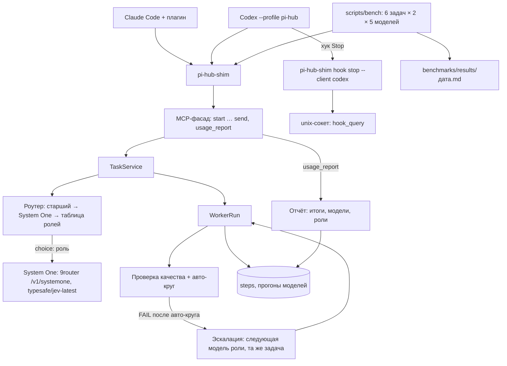

# Specification: Этап 3 — роутинг, эскалация, Codex и отчёт о расходах

**Date:** 2026-11-27
**Priority:** P1
**Type:** Extension
**Предыдущий этап:** [2026-11-27-stage-2-questions-quality.md](2026-11-27-stage-2-questions-quality.md) (FR-101…FR-130). Требования этого этапа нумеруются с FR-201, решения — с D-201.

## 1. Problem

- **Codex не может работать архитектором.** Профиль Codex лежит в репозитории, но его надо копировать руками, а хуки в нём указывают на несуществующую команду `pi-hub hook …`. Хук Stop этапа 2 сделан только для Claude Code. `doctor` про Codex ничего не знает.
- **Задача не уходит на модель сильнее.** Если дешёвая модель не справилась и после авто-круга, задача заканчивается `FAIL`, и старшему приходится разбирать неудачу самому. Поле `escalate` в таблице ролей есть, но не используется.
- **Роль без подсказки старшего всегда `default_role`.** Умный роутер описан в ADR-0008, но не сделан. При этом маршрут System One доступен через 9router: проверено на `typesafe/jev-latest` (→ `jev-1.14.0`), Clef-flash и Jev 1.13 — ответ за 0,5–1,5 с.
- **Расходы видны только по одной задаче.** Строка стоимости есть в `wait`/`result`, а на вопрос «сколько потрачено на проект за неделю и на какой модели» ответа нет: `usage_report` объявлен в протоколе, но не реализован.
- **Нет данных, какая дешёвая модель лучше.** Таблица ролей заполняется наугад; эталонных задач нет (`benchmarks/tasks/` — только README).

## 2. Goal

Codex работает архитектором наравне с Claude Code. Задача, которую дешёвая модель не довела до `PASS`, сама продолжается на следующей модели цепочки роли. Роль задачи без подсказки старшего выбирает умный роутер. Старший отвечает на вопрос о расходах одним вызовом `usage_report`, а таблица ролей опирается на замер пяти моделей на эталонных задачах.

## 3. Current state

- **Роутер** `packages/hub/src/router/model-resolver.ts`: модель старшего → роль → `default_role`; `fallback`/`escalate` в схеме роли есть (`config/schema.ts`, `RoleRule`), но не используются. `routed_by` = `architect | rules`.
- **Конфиг умного роутера** `config/schema.ts`: `router.smart` и `router.system_one {preset, url, api_key_env, model, timeout_ms, min_confidence}` — только схема; адаптера нет. `pi-hub init` пишет `router: { smart: false }`.
- **Авто-круг и вердикт** `tasks/worker-runner.ts`: после второго `FAIL` задача становится `done` с `FAIL`. Ошибки, которые были на базе, помечены (`QualityRun.commands[].failedOnBase`).
- **Учёт** `accounting/accounting.ts`, `storage/repos.ts`: шаги задачи (`steps`), итоги по задаче и сессии, неизвестные цены; отчётов по периоду, проекту, модели и роли нет.
- **Протокол** `packages/protocol/src/tools.ts`: `UsageReportInput {scope: session|project|all, period: day|week|month|all}` объявлен, инструмента в фасаде нет.
- **Codex** `plugins/codex/`: `pi-hub.config.toml` (MCP `pi-hub-shim --client codex`, `tool_timeout_sec = 900`, хуки `pi-hub hook session-start|stop --client codex` — такой команды нет), `hooks/hooks.json`, README. Список инструментов для `codex` — статический (ADR-0010, `CLIENT_DEFAULTS`). `init` Codex не трогает.
- **Хук Stop** `packages/shim/src/hook.ts` + `sessions/hook-*.ts`: принимает `--client`, сессию ищет по предкам процесса; проверено только на Claude Code.
- **Эталоны** `benchmarks/tasks/README.md` — описание формата; задач и скрипта прогона нет. Сквозной прогон на настоящем Pi — `scripts/e2e.ts`.
- **Модели для сравнения** (видны Pi через расширение 9router): `9router/Deepseek-v4.1-flash`, `9router/glm-5.3-flash`, `9router/Hy4-flash`, `9router/gpt-oss-120b`, `9router/Inkling-2-small`.

## 4. User scenarios

### Scenario 1: Codex — архитектор (P1)
**As** разработчик в Codex, **I want** делегировать задачи воркерам pi-hub так же, как из Claude Code, **so that** дорогая модель Codex тратится только на постановку и приёмку.

**Steps:**
1. `pi-hub init` ставит профиль `~/.codex/pi-hub.config.toml` и подсказывает разовый шаг: открыть `codex --profile pi-hub` и доверить хук pi-hub в `/hooks`.
2. Пользователь работает в `codex --profile pi-hub`, включает режим архитектора; старший вызывает `start`, `wait`, `send`.
3. Воркер задаёт вопрос; старший получает его в `wait` и в строке ответов; если пытается закончить ход, хук Stop один раз возвращает его к вопросу.

**Acceptance criteria (Given / When / Then):**
- [ ] Given нет файла профиля, when пользователь запускает `pi-hub init`, then создаётся `~/.codex/pi-hub.config.toml` с MCP-сервером pi-hub и хуком Stop, а вывод `init` содержит инструкцию про `/hooks`.
- [ ] Given профиль уже есть и в нём записаны доверие к хукам (`[hooks.state…]`), доверенные папки (`[projects…]`) и комментарии, when `pi-hub init` запускается снова, then эти секции, комментарии и любые не-pi-hub ключи сохраняются без изменений, ключи pi-hub обновляются, а рядом лежит копия прежнего файла `pi-hub.config.toml.bak`.
- [ ] Given Codex-сессия в профиле pi-hub подключилась, when старший вызывает `start` до включения режима, then хаб отклоняет вызов с подсказкой включить режим; список инструментов при этом полный (статический).
- [ ] Given у Codex-сессии открыт вопрос воркера и режим `on`, when Codex заканчивает ход, then хук Stop блокирует остановку один раз и передаёт текст вопроса; повторно не блокирует.
- [ ] Given профиль установлен, но хук не доверен, when пользователь запускает `pi-hub doctor`, then проверка «хук Codex» предупреждает и называет шаг `/hooks`; после доверия — ✓.
- [ ] Given обычный `codex` без профиля, then инструментов pi-hub в нём нет.

### Scenario 2: Эскалация на модель сильнее (P1)
**As** старший агент, **I want** чтобы задача, которую дешёвая модель не довела до PASS, сама продолжилась на модели сильнее, **so that** не тратить свои токены на разбор неудачи.

**Steps:**
1. Роль `code` в таблице: `model: 9router/Deepseek-v4.1-flash`, `escalate: [9router/glm-5.3-flash]`.
2. Воркер сдаёт работу с новой ошибкой проверки; авто-круг не помогает.
3. Хаб запускает ту же задачу на `glm-5.3-flash` в новой сессии Pi с той же ветки, передав текст задачи, итог прошлой модели и замечания проверки.
4. `wait` старшего продолжает ждать ту же задачу; конверт показывает итог, историю моделей и предупреждение об эскалации.

**Acceptance criteria (Given / When / Then):**
- [x] Given у роли задачи есть следующая модель в `escalate`, when проверка после авто-круга снова `FAIL` хотя бы на одной ошибке, которой не было на базе, then задача с тем же `task_id` переходит на следующую модель, работа продолжается в той же ветке и worktree, а `wait` старшего не возвращается до итогового результата.
- [x] Given эскалация произошла, when старший получает конверт, then в `warnings` есть «эскалировано: <модель A> → <модель B>», в конверте — модели задачи по порядку, стоимость включает шаги обеих моделей.
- [x] Given все ошибки проверки были и на базе («падало до задачи»), then эскалации нет.
- [x] Given цепочка `escalate` закончилась (или её нет), when проверка снова `FAIL`, then задача завершается `done` с `FAIL`, как на этапе 2.
- [x] Given модель задачи старший указал явно (`start(model=…)`), then эскалации нет (D-211).
- [x] Given задача в эскалации, when старший вызывает `cancel`, then задача `cancelled`, ветка сохраняется.

### Scenario 3: Умный роутер выбирает роль (P2)
**As** старший агент, **I want** не указывать роль в каждом `start`, **so that** задача сама уходит на модель нужной роли.

**Steps:**
1. `pi-hub init` спрашивает «использовать умный роутер?» и предлагает пресеты; пользователь выбирает 9router, модель `typesafe/jev-latest`, имя переменной ключа; ключ пользователь кладёт в `~/.pi-hub/.env` сам.
2. Старший вызывает `start` без `role`.
3. Хаб спрашивает System One, какая роль из таблицы подходит, и берёт её при уверенности не ниже порога.

**Acceptance criteria (Given / When / Then):**
- [x] Given умный роутер включён и `start` без `role` и без `model`, when System One отвечает с уверенностью ≥ `min_confidence`, then задача получает эту роль и модель роли, `routed_by = system_one`, а в `route_reason` — роль и уверенность.
- [x] Given уверенность ниже `min_confidence`, then задача получает `default_role`, а `route_reason` называет уверенность и порог.
- [x] Given System One недоступен, ответ дольше `timeout_ms` (по умолчанию 3 с) или не прошёл проверку формата, then задача создаётся по правилам (`default_role`), `route_reason` содержит `system_one_unavailable`, `start` возвращается не позже чем через `timeout_ms` + 1 с.
- [x] Given `start` с `role` или `model`, then System One не вызывается.
- [x] Given запрос к System One выполнен, then он записан шагом задачи с фактической моделью из ответа (например, `jev-1.14.0` для `jev-latest`) и стоимостью по общей цепочке источников (этап 2, FR-116).
- [x] Given `pi-hub router test`, then хаб отправляет один тестовый вопрос и печатает модель, задержку, ответ и стоимость, если провайдер её вернул.

### Scenario 4: Отчёт о расходах (P1)
**As** пользователь, **I want** спросить старшего «сколько потрачено на проект за неделю и на чём», **so that** понимать расходы по моделям и ролям.

**Steps:**
1. Старший вызывает `usage_report(scope="project", period="week")`.
2. Хаб возвращает итоги и разрезы по моделям и ролям; старший пересказывает пользователю одной-двумя фразами.

**Acceptance criteria (Given / When / Then):**
- [x] Given задачи в разных сессиях и проектах, when `usage_report` вызван со `scope` session / project / all и `period` day / week / month / all, then в отчёт попадают только шаги задач этой сессии / проекта текущей сессии / всех и только за период.
- [x] Given отчёт, then в нём есть итог (сумма, вход и выход, доля кэша, число задач, число шагов с неизвестной ценой) и разрезы по моделям и по ролям: задачи, стоимость, доля PASS с первого раза, средняя стоимость задачи с итоговым PASS.
- [x] Given есть шаги с неизвестной ценой, then суммы помечены «без учёта N шагов с неизвестной ценой»; модель, у которой цена неизвестна для всех шагов, показана с «цена неизвестна».
- [x] Given 20 моделей и 10 ролей в периоде, then ответ `usage_report` не больше 2 КБ (разрезы сокращаются до самых дорогих позиций с пометкой «и ещё N»).
- [x] Given среди задач периода есть задачи без команд проверки (`SKIPPED`), then они не входят в долю PASS с первого раза, а отчёт показывает «без проверки: N».
- [x] Given режим `off`, then `usage_report` отклоняется, как остальные инструменты делегирования.

### Scenario 5: Сравнение моделей на эталонных задачах (P1)
**As** автор таблицы ролей, **I want** прогнать одни и те же задачи на пяти моделях, **so that** выбрать основную модель и цепочку эскалации по данным.

**Steps:**
1. Пользователь запускает прогон эталонов на пяти моделях 9router.
2. Скрипт для каждой задачи и модели делает два запуска через настоящий хаб во временном репозитории, отвечает на вопросы воркера заготовленными ответами и собирает результаты.
3. Результат — таблица в `benchmarks/results/`: по модели доля PASS с первого раза, итоговый PASS, стоимость (или токены, если цена неизвестна), время, число вопросов.

**Acceptance criteria (Given / When / Then):**
- [ ] Given в `benchmarks/tasks/` 6 задач (исправление ошибки, функция с тестами, рефакторинг, задача с обязательным вопросом, документация, типы), каждая с текстом, условиями приёмки, исходным репозиторием и командами проверки, when прогон запущен на N моделях, then выполняется 6 × 2 × N запусков, и каждый получает итог (PASS с первого раза / PASS после авто-круга / FAIL / ошибка).
- [ ] Given прогон завершён, then в `benchmarks/results/<дата>.md` таблица по моделям и сводка по задачам; эскалация в прогоне выключена, чтобы мерить саму модель.
- [ ] Given провайдер ответил 429, 5xx или оборвал соединение, then запуск повторяется с паузой до 3 раз; не прошедший — «ошибка провайдера» в отдельной колонке, не `FAIL` модели.
- [ ] Given прогон прервали, when его запускают снова с тем же каталогом результатов, then уже выполненные запуски не повторяются.
- [ ] Given у задачи есть обязательный вопрос, then скрипт отвечает на него заготовленным ответом через `send`, а задача без ответа не висит дольше заданного таймаута (запуск помечается «ошибка»).

## 5. Functional requirements

### Must Have (P0)
- **FR-201**: Таблица ролей: у роли — основная модель, необязательная цепочка `escalate` и короткое описание (для выбора роли умным роутером). `doctor` предупреждает о моделях ролей, которых Pi не видит.
- **FR-202**: Эскалация: если проверка после авто-круга (этап 2, FR-113) снова `FAIL` хотя бы на одной новой ошибке, а у роли задачи есть следующая модель в `escalate`, хаб продолжает ту же задачу (тот же `task_id`, ветка, worktree) на следующей модели в новой сессии Pi. Воркер получает текст задачи, итог прошлой модели и замечания проверки. После работы — обычные финализация, проверка и авто-круг; при новом `FAIL` — следующая модель, пока цепочка не кончится.
- **FR-203**: Эскалация не запускается, если все упавшие команды падали и на базе, если модель задачи указал старший, при отмене и после `send` старшего на `done` (доработку ведёт модель, на которой задача закончилась).
- **FR-204**: Эскалация видна старшему: `wait` продолжает ждать ту же задачу; конверт содержит «эскалировано: A → B», список моделей задачи по порядку, стоимость по всем моделям; `routed_by` последней модели — `escalation`.
- **FR-205**: Хранение истории моделей задачи: какая модель, почему (роль / старший / роутер / эскалация), когда начала и закончила, итог её проверки; признак «PASS с первого раза» (итоговый `PASS` первой модели без авто-круга, эскалации и `send`). Задачи без команд проверки (`SKIPPED`) в долю PASS не входят ни числителем, ни знаменателем (D-215).
- **FR-206**: `usage_report(scope, period)`: итоги и разрезы по моделям и ролям по требованиям сценария 4; задачи без проверки показаны отдельно («без проверки: N»); ответ ≤ 2 КБ; отклоняется при режиме `off`.
- **FR-207**: Профиль Codex: MCP-сервер `pi-hub-shim --client codex`, `tool_timeout_sec = 900`, автоодобрение вызовов pi-hub, хук Stop `pi-hub-shim hook stop --client codex`. Хука SessionStart нет (сессию находят по предкам процесса, D-212). Если фаза 0 покажет, что поиск по предкам для Codex не работает, профиль получает хук SessionStart, который связывает `session_id` Codex с сессией хаба (D-213).
- **FR-208**: `pi-hub init` ставит профиль Codex, если Codex установлен: создаёт файл или обновляет только ключи pi-hub, сохраняя доверие (`[hooks.state…]`), доверенные папки (`[projects…]`) и чужие ключи; печатает инструкцию про `/hooks`. Перед изменением существующего файла — копия `pi-hub.config.toml.bak`. Флаг `--no-codex` пропускает шаг.
- **FR-209**: Хук Stop для Codex: тот же `pi-hub-shim hook stop`, клиент `codex`, формат ответа Codex (`decision: block` + `reason`), те же правила (один блок на вопрос, не блокирует при `off`, при `stop_hook_active`, при недоступном хабе; ≤ 100 мс).
- **FR-210**: `doctor` проверяет Codex: профиль на месте, команды хука и MCP-сервера верные, хук pi-hub доверен (есть запись `trusted_hash`); без Codex — строка «Codex не установлен» без ошибки.
- **FR-211**: Эталонные задачи: 6 задач в `benchmarks/tasks/NN-имя/` (текст, условия приёмки, исходный репозиторий, `.pi-hub.toml` с проверкой, заготовленные ответы на вопросы).
- **FR-212**: Прогон эталонов: скрипт запускает задачи через настоящий хаб на списке моделей, по 2 запуска, с выключенной эскалацией; продолжает прерванный прогон; пишет `benchmarks/results/<дата>.md` и сырые данные рядом. Ошибки провайдера (429, 5xx, обрыв соединения) повторяются с паузой до 3 раз; не прошедший после повторов запуск помечается «ошибка провайдера» и не считается `FAIL` модели (D-214).

### Should Have (P1)
- **FR-220**: Умный роутер (ADR-0008, только выбор роли): при `start` без `role` и `model` — один `choice`-вопрос System One по ролям таблицы (по их описаниям); роль берётся при уверенности ≥ `min_confidence`, иначе `default_role`; отказ, таймаут (`timeout_ms`, 3 с) или неверный ответ — правила и причина `system_one_unavailable`. Если в таблице одна роль, System One не вызывается.
- **FR-221**: Пресеты System One — данные, не код: TypeSafe, 9router (`https://omni-fr.archteam.org/v1/systemone`, модель по умолчанию `typesafe/jev-latest`), OpenRouter, Ollama, свой адрес. Ключ — только имя переменной в конфиге, значение — в `~/.pi-hub/.env`.
- **FR-222**: Запрос System One — шаг задачи: фактическая модель из ответа, токены, стоимость по цепочке источников этапа 2 (FR-116); роль шага — роутер.
- **FR-223**: `pi-hub init`: шаг «использовать умный роутер?» (нет / пресет / свой адрес, модель, имя переменной ключа, тестовый вопрос). Неинтерактивно: `--router off` или `--router-preset`, `--router-model`, `--router-key-env`.
- **FR-224**: `pi-hub router status | test | off`; `doctor` показывает состояние умного роутера и предупреждает, если ключа нет в `.env`, у ролей нет описаний или подряд было 3+ сбоев.
- **FR-225**: Скил архитектора (Claude Code и Codex): `usage_report` для вопросов о расходах; эскалация — не повод начинать задачу заново; роль можно не указывать, если включён умный роутер.

### Nice to Have (P2)
- **FR-230**: `pi-hub status` показывает модель задачи с пометкой эскалации («glm-5.3-flash ↑»).

## 6. Non-functional requirements

- **Производительность:** запрос System One не задерживает `start` больше чем на `timeout_ms` + 1 с; хук Stop Codex — как у Claude Code, ≤ 100 мс (95-й перцентиль); `usage_report` по базе в 10 000 шагов — ≤ 200 мс.
- **Безопасность:** ключ System One — только в `~/.pi-hub/.env`; в конфиге имя переменной; в логах, шагах и результатах эталонов ключа нет. Профиль Codex не содержит ключей. `init` не ставит доверие к хукам Codex за пользователя.
- **Совместимость:** Codex CLI 0.172 (проверено 0.171 — ADR-0009); версия протокола shim ↔ хаб повышается, если меняются сообщения (новый инструмент `usage_report` — изменение MCP-фасада, а не протокола shim).

## 7. Data model (conceptual)

```
Task (дополнение)
  - models: список прогонов модели (см. TaskModelRun)
  - first_try_pass: да / нет / неизвестно (задача ещё идёт)

TaskModelRun (новое)
  - task → Task
  - model: <провайдер>/<модель>
  - routed_by: architect | rules | system_one | escalation
  - reason: текст
  - started_at, finished_at
  - quality: PASS | FAIL | SKIPPED | — (итог проверки этого прогона)

Step (дополнение)
  - kind: worker | router    (шаг воркера или запрос System One)
  - model: фактическая модель из ответа

Role (конфиг)
  - model, escalate[], description
Router (конфиг)
  - smart: да/нет, preset, url, api_key_env, model, timeout_ms, min_confidence
```

`usage_report` строится по шагам и прогонам моделей; «PASS с первого раза» — по первому прогону задачи.

## 8. User interface

- **`usage_report`** (ответ старшему, ≤ 2 КБ), пример строк: `неделя, проект pi-hub-try: 1,24 $ без учёта 37 шагов с неизвестной ценой · 3,1M вход (64% из кэша) · 120k выход · 18 задач`; `по моделям: Deepseek-v4.1-flash — 12 задач, PASS с первого раза 58%, цена неизвестна; glm-5.3-flash — 6 задач, 67%, 0,84 $`.
- **Конверт:** `models: ["9router/Deepseek-v4.1-flash", "9router/glm-5.3-flash"]`, предупреждение `эскалировано: Deepseek-v4.1-flash → glm-5.3-flash (FAIL после авто-круга)`.
- **`pi-hub init`:** шаги «Умный роутер?», «Профиль Codex» с выводом «доверьте хук pi-hub: codex --profile pi-hub → /hooks».
- **`benchmarks/results/<дата>.md`:** таблица `модель | PASS с первого раза | PASS итог | FAIL | ошибки провайдера | стоимость или токены | среднее время | вопросы`.

## 9. Architecture (overview)



## 10. Out of scope

- System One для сложности, фазы плана, критичности вопросов, риска диффа и зависания воркера (только выбор роли, D-204).
- Консультант для некритичных вопросов (F12).
- Эскалация при падении воркера (`failed`) — только по `FAIL` проверки.
- Смена модели внутри одной сессии Pi с «липкостью», недельные предложения по таблице ролей, веб-панель — этап 5.
- Многосессионность, сироты, adopt, квоты, удалённая работа — этап 4.
- Оценка экономии против старшей модели и счётчики вопросов/эскалаций в `usage_report` (D-209).
- Автоматическая правка таблицы ролей по итогам эталонов: выводы делает пользователь.

## 11. Deferred questions

| Question | Why deferred | When the answer is needed | Who decides |
|----------|--------------|---------------------------|-------------|
| — | — | — | — |

## 12. Spec decisions

| # | Question | Decision | Date |
|---|----------|----------|------|
| D-201 | Когда эскалировать | Сразу после авто-круга: вторая подряд `FAIL`-проверка на новой ошибке → следующая модель цепочки без участия старшего. Работа доводится сама; цена — ещё один запуск воркера на модели дороже | 2026-11-27 |
| D-202 | Откуда начинает модель эскалации | С ветки упавшей задачи: коммиты слабой модели, её итог и замечания проверки уходят сильной. Исправить дешевле, чем переписать; риск — унаследовать неудачные решения | 2026-11-27 |
| D-203 | Та же задача или новая | Та же задача (`task_id`, ветка, worktree), новая сессия Pi на новой модели; старший продолжает `wait`; история моделей и сумма стоимости — в конверте. Поле `escalated_from_task_id` не используется | 2026-11-27 |
| D-204 | Какие решения у умного роутера | Только роль задачи, когда старший её не указал. Сложность, фаза плана, критичность вопросов, риск и зависание — позже | 2026-11-27 |
| D-205 | Модель System One по умолчанию | `typesafe/jev-latest` на маршруте 9router: не привязана к версии, новая версия подхватывается сама. Фактическая модель из ответа пишется в шаг (сейчас `jev-1.14.0`). Стоимости в ответе нет — «цена неизвестна» или ручная цена | 2026-11-27 |
| D-206 | Провайдер System One без отдельного ключа | Маршрут `https://omni-fr.archteam.org/v1/systemone` того же 9router: формат `{model, state, questions}` с вопросами-объектами, проверен на Jev и Clef. Ключ 9router пользователь кладёт в `~/.pi-hub/.env` сам | 2026-11-27 |
| D-207 | Режим при подключении Codex | Выключен, как везде (BD-003): инструменты видны (статический список), хаб отклоняет вызовы до `/architect on` | 2026-11-27 |
| D-208 | Установка профиля Codex | `pi-hub init` создаёт профиль или обновляет только ключи pi-hub, сохраняя доверие и чужие ключи; доверие к хуку ставит пользователь в `/hooks` (ADR-0009) | 2026-11-27 |
| D-209 | Содержание `usage_report` | Итоги + разрезы по моделям и ролям (задачи, стоимость, PASS с первого раза, стоимость успешной задачи). Без оценки экономии и счётчиков вопросов/эскалаций: каждый разрез стоит токенов старшего | 2026-11-27 |
| D-210 | Объём эталонного прогона | 6 задач × 2 запуска на 5 моделях 9router (`Deepseek-v4.1-flash`, `glm-5.3-flash`, `Hy4-flash`, `gpt-oss-120b`, `Inkling-2-small`) = 60 запусков; два запуска показывают разброс. Эскалация в прогоне выключена | 2026-11-27 |
| D-211 | Эскалация при модели от старшего | Не эскалировать: старший выбрал модель явно (например, чтобы сравнить или проверить её), хаб её не подменяет; `FAIL` идёт старшему | 2026-11-27 |
| D-212 | Хук SessionStart для Codex | Не нужен: сессию хука находят по предкам процесса (этап 2, PD-107) и запасным путём по проекту. В профиле остаётся только хук Stop. Дерево процессов хука Codex проверяется в фазе 0 плана | 2026-11-27 |
| D-213 | Предсмертный разбор: хук Codex не находит сессию по предкам | Фаза 0 проверяет дерево процессов Codex; если поиск не работает — профиль получает хук SessionStart, связывающий `session_id` Codex с сессией хаба (ADR-0007) | 2026-11-27 |
| D-214 | Предсмертный разбор: лимиты и обрывы 9router портят таблицу эталонов | Повтор с паузой до 3 раз; оставшиеся — «ошибка провайдера» отдельной колонкой, не `FAIL` модели | 2026-11-27 |
| D-215 | Предсмертный разбор: «PASS с первого раза» искажают задачи без проверки | `SKIPPED` не входит в долю ни числителем, ни знаменателем; отдельная строка «без проверки: N» | 2026-11-27 |
| D-216 | Предсмертный разбор: `init` портит профиль Codex и сбрасывает доверие | Копия `pi-hub.config.toml.bak` перед изменением, правка только ключей pi-hub с сохранением комментариев; тест на файле с доверием | 2026-11-27 |

## 13. Success criteria

- [ ] Ворота этапа 3 (бриф §9): доля PASS с первого раза измерена на 6 эталонных задачах × 2 запуска по 5 моделям 9router; таблица в `benchmarks/results/`.
- [ ] Интеграционные тесты на фейковом воркере: эскалация после авто-круга на следующую модель в той же задаче и ветке; нет эскалации при ошибках с базы, при модели от старшего, после `send`, при пустой цепочке; история моделей и стоимость в конверте.
- [ ] Модульные тесты роутера: выбор роли по ответу System One, порог уверенности, таймаут и неверный ответ → правила; контрактный тест на записанных ответах маршрута 9router (Jev и Clef).
- [ ] `usage_report`: тесты на выборку по scope/period, разрезы, неизвестные цены, ответ ≤ 2 КБ на 20 моделях и 10 ролях.
- [ ] Codex: `init` ставит профиль и сохраняет доверие при повторном запуске (тест на файле с `[hooks.state…]`); хук Stop с `--client codex` блокирует один раз (интеграционный тест через shim); ручной прогон в `codex --profile pi-hub`: вопрос воркера, хук Stop, ответ, итог.
- [ ] Живая проверка умного роутера: `pi-hub router test` и задача без `role` на 9router (`typesafe/jev-latest`) получает роль от System One.
- [ ] `pnpm build`, `pnpm lint`, `pnpm typecheck`, `pnpm test` зелёные в CI.
